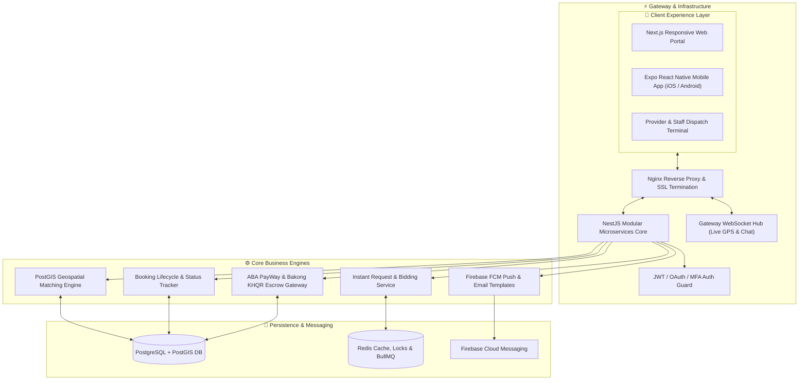
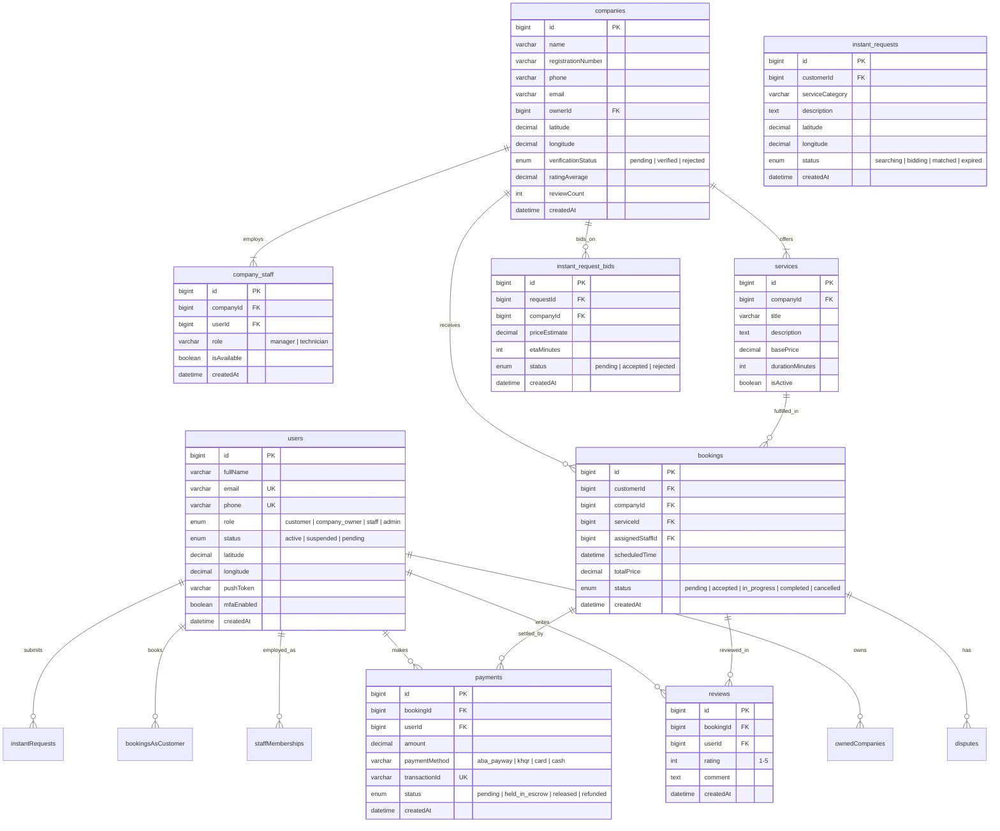
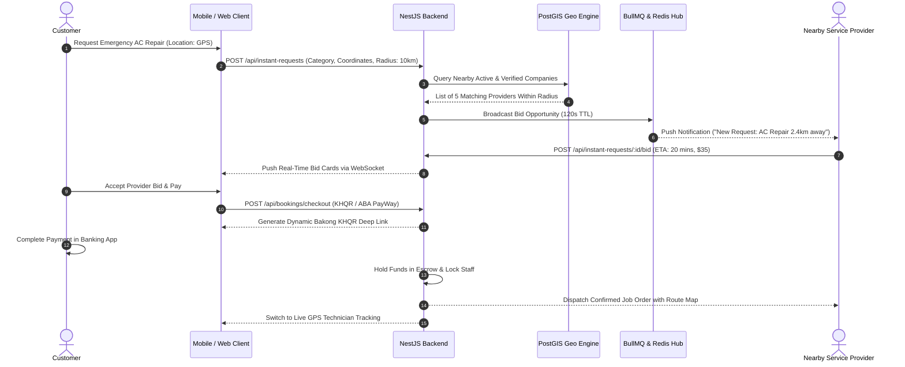

# ServiceFinder — Hyperlocal On-Demand Service Marketplace & Dispatch Ecosystem

<div align="center">


**An enterprise multi-sided on-demand services platform connecting customers with verified companies and freelance specialists, featuring real-time geospatial dispatch, bidding, and KHQR/ABA escrow settlements.**

[System Architecture](#-system-architecture) • [Database ERD](#-database-entity-relationship-diagram) • [Dispatch Sequence](#-hyperlocal-dispatch--booking-flow) • [Quick Start](#-quick-start)

</div>

---

## ⚡ Overview

**ServiceFinder** is an on-demand service ecosystem designed for home repairs, cleaning, mechanics, and certified professional services. It combines a Next.js web portal, an Expo React Native cross-platform mobile app, and a robust NestJS backend with PostGIS spatial indexing for precision distance matching, real-time live location dispatch, and Cambodian/international payment gateways.

---

## 🏗 System Architecture



---

## 📊 Database Entity-Relationship Diagram



---

## 🔄 Hyperlocal Dispatch & Booking Flow



---

## 📦 Key Capabilities

- **Hyperlocal Geo-Dispatching**: Spatial indexing matches customers with the closest qualified service technicians in real time.
- **Reverse Bidding Engine**: Broadcast immediate job needs and allow certified specialists to submit instant bids with ETAs.
- **Escrow & Multi-Rail Payments**: Integrates Cambodian Bakong KHQR, ABA PayWay, and credit cards with payment escrow release on job completion.
- **Cross-Platform Mobile App**: Native iOS & Android support via Expo React Native with push notifications and GPS location tracking.
- **Company Management Portal**: Dedicated dashboards for service providers to manage staff, assign tickets, and review revenue reports.

---

## 🚀 Quick Start

### 1. Backend Service (NestJS)
```bash
cd backend-nest
pnpm install

# Setup Environment
cp .env.example .env
# Set DATABASE_URL, REDIS_HOST, ABA_MERCHANT_ID, FIREBASE_CREDENTIALS

# Run Database Migrations
pnpm prisma db push

# Start NestJS API
pnpm run start:dev
```

### 2. Frontend Web Portal (Next.js)
```bash
cd ../frontend
pnpm install
pnpm run dev
```

### 3. Mobile App (Expo)
```bash
cd ../frontend-expo
pnpm install
pnpm run start
```

---

## 📄 License
Proprietary & Confidential — Engineered by **[Ros Rendo](https://github.com/RosRendo)**