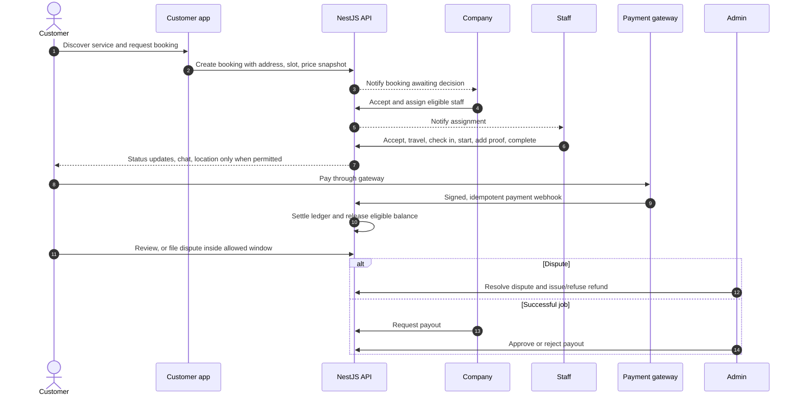

# Service Finder — 10/10 Product Improvement Plan

**Status:** Working launch plan  
**Audience:** Product owner, design, mobile, web, backend, QA, and operations  
**Purpose:** Turn the existing Service Finder codebase into a trustworthy, complete, launch-ready marketplace.  
**Last reviewed:** 2026-08-11

---

## 1. The definition of “10/10”

A 10/10 Service Finder is not the app with the most screens. It is the app where every role can complete its important work reliably, safely, and without needing staff intervention.

### Launch standard

The product is ready to launch only when all of the following are true:

- A customer can discover a real provider, book, pay, receive updates, track the job, review it, and obtain help if something goes wrong.
- A verified company can configure its profile/services/coverage, receive a booking, assign a qualified staff member, and receive a correct payout.
- Staff can see an assigned job, communicate safely, navigate, check in, submit required proof, complete the job, and see earnings.
- An admin can verify companies, protect users, resolve disputes, process or reject payouts/refunds, and prove what happened through immutable audit logs.
- Money, booking status, permissions, messages, notifications, and location updates remain correct if a user retries, loses internet, or a third-party service fails.
- Mobile and web are accessible, responsive, localized, monitored, secure, and covered by automated tests.

### Quality scorecard

| Dimension | Current working baseline | 10/10 target | What proves the target |
|---|---:|---:|---|
| Core feature coverage | Strong screen/API inventory | Complete journeys | Every critical journey passes on staging |
| Workflow integration | Partial | End-to-end | No manual or mocked step between booking and settlement |
| UX/UI consistency | Partial | Excellent | Shared design system, accessibility, native/mobile adaptation |
| Security and permissions | Good foundations | Release-ready | Independent security review plus role-permission tests |
| Reliability and operations | Partial | Release-ready | Alerts, tested restores, runbooks, rollback, SLOs |
| Test confidence | Limited | High | Unit, integration, E2E, payment sandbox and device smoke tests |

---

## 2. Source of truth and documentation cleanup

Before implementing more features, reconcile documentation with the shipped routes and API behavior. Existing documents contain valuable scope but some old route names and implementation claims.

### Required source-of-truth set

| Document | Owner | Required update |
|---|---|---|
| `01_PRD.md` | Product | Define MVP, non-goals, markets, supported payment methods, and success metrics |
| `04_USER_FLOWS.md` | Product + Design | Replace aspirational flows with tested, current flows and explicit exception paths |
| `08_PERMISSIONS.md` | Backend + Security | Map every permission to API guard/policy tests |
| `21_API_MASTER_MAP_AND_FEATURE_GAP.md` | Backend + Frontend | Re-run endpoint-to-UI mapping and mark each endpoint as integrated, unused, or deprecated |
| This document | Tech lead | Maintain priorities, owners, release gates, and progress |

### Documentation rule

Do not call a feature “complete” because an endpoint or screen exists. It is complete only when it has:

1. A defined user outcome and permission policy.
2. A UI path on each promised platform.
3. A real API/database implementation.
4. Loading, empty, offline, error, and retry states.
5. Automated tests and staging acceptance evidence.
6. Monitoring/audit evidence if it affects money, access, or safety.

---

## 3. The critical marketplace journey

### Non-negotiable state model

Use one documented state machine rather than allowing each screen or role to invent a status.

| Booking state | Allowed actor/action | Required side effects |
|---|---|---|
| `pending` | Company accepts, rejects, or customer cancels under policy | Audit record; customer/company notification |
| `assigned` | Company assigns; staff accepts/rejects | Verify staff belongs to company and is available |
| `confirmed` | Staff begins travel | Customer notification; expose limited live location only when permitted |
| `arrived` | Staff checks in | Timestamp and optional geo/proof validation |
| `in_progress` | Staff starts work | Customer notification; work evidence enabled |
| `completed` | Staff submits proof; customer review window opens | Idempotent financial settlement eligibility; audit log |
| `cancelled` | Authorized actor cancels | Apply cancellation/refund policy once only |
| `disputed` | Customer/company/admin files dispute | Freeze affected funds; restrict normal settlement actions |
| `refunded` / `settled` | Admin/payment workflow finalizes | Immutable ledger and notification |

**Rule:** All state changes must be authorized server-side, transactional where financial records change, idempotent, and recorded in booking/audit history.

---

## 4. Feature completion matrix by role

### 4.1 Public and authentication

| Capability | Target behavior | Completion evidence |
|---|---|---|
| Onboarding and guest browsing | Guest can browse but is asked to authenticate before protected actions | Mobile test + product decision for every protected action |
| Email/password, phone OTP, social login | Clear recovery path, rate limits, no account enumeration | E2E tests and rate-limit test |
| MFA for privileged roles | Admin and company owner enrollment/recovery/lockout flows | Admin security acceptance test |
| Session lifecycle | Short-lived access token, refresh, logout-all, revoked session behavior | Unit/integration tests |
| Account recovery | Expiring single-use codes and clear error states | E2E test with expired/used code |

### 4.2 Customer

| Capability | Priority | Definition of done |
|---|---|---|
| Discovery, category, search, map | P1 | Results are paginated, filterable, location-aware, empty/error states are clear |
| Company/service detail | P1 | Real service, pricing, availability, reviews, and policy shown; no demo fallback in production |
| Address and availability | P0 | Validated address, saved address, slot/timezone rules, serviceable-area validation |
| Booking and price quote | P0 | Server creates immutable price/commission/tax snapshot; no client-calculated final price |
| Checkout | P0 | Payment success/failure/pending/retry and webhook reconciliation work in sandbox |
| Booking activity | P0 | Accurate active/history states with cancellation and reschedule policies |
| Tracking and chat | P1 | Live status; location only from `en_route` until arrival; attachment/report abuse paths |
| Reviews and saved providers | P1 | Only eligible completed booking can review; moderation/report flow exists |
| Support and disputes | P0 | Customer can file a dispute with evidence and see status/resolution |

### 4.3 Company admin

| Capability | Priority | Definition of done |
|---|---|---|
| Company onboarding/KYB | P0 | Business data and documents uploaded, pending state shown, admin decision notified |
| Service catalog and pricing | P0 | Validation, price/time estimates, publish/unpublish, image handling, audit trail |
| Coverage and availability | P0 | Customer cannot book outside area or unavailable slot |
| Booking operations | P0 | Accept/reject/assign/reassign with collision and availability checks |
| Staff management | P0 | Invite, deactivate, role scope, availability, documents, notes, and history |
| Inbox and customer updates | P1 | Real-time unread state, booking context, escalation/report route |
| Analytics/marketing | P2 | Metrics have defined calculations and time zones; promotions enforce rules server-side |
| Wallet/payouts/subscription | P0 | Ledger-backed balances, bank verification, payout state/rejection reasons, invoices |

### 4.4 Staff

| Capability | Priority | Definition of done |
|---|---|---|
| Today, calendar, and messages navigation | P0 | Calendar/schedule and chat are first-class reachable destinations, not hidden/deep-only routes |
| Assignment decision | P0 | Staff can accept/reject only jobs assigned to them; company is notified |
| Job execution | P0 | Start journey, arrive/check in, start work, proof upload, complete job; each action server-authorized |
| Maps and location | P1 | Explicit permission, background policy, battery-aware updates, customer privacy limit, fallback when denied |
| Communication | P1 | Conversation is restricted to linked booking participants and supports reporting/blocking escalation |
| Earnings/performance | P1 | Balances are derived from ledger; no client-side financial totals |
| Availability/time off | P1 | Company scheduling honors changes and conflicting jobs are prevented |

### 4.5 Global admin

| Capability | Priority | Definition of done |
|---|---|---|
| User/company verification and suspension | P0 | Decision requires reason, is audited, notifies user, and revokes/limits access correctly |
| Disputes and refunds | P0 | Evidence view, decision notes, financial action via idempotent payment workflow, immutable audit record |
| Payout approval | P0 | Dual-control option, reconciliation, approval/rejection record, bank destination protection |
| Moderation/support/broadcasts | P1 | Clear permissions, targeting, delivery/read outcomes, abuse prevention |
| Taxonomy, pricing rules, commission | P1 | Draft/publish/audit behavior; safe impact preview for price changes |
| Analytics, monitoring, audit | P1 | Metric definitions, filters, export permissions, retention policy |

---

## 5. UX and design improvement plan

### Mobile app priorities

1. Create a single reusable role-aware navigation component. Avoid four duplicated custom floating tab bars.
2. Restore the intended Staff calendar and chat destinations in the primary navigation.
3. Replace raw colors with semantic tokens covering light, dark, success, warning, destructive, and disabled states.
4. Add explicit accessibility labels, roles, selected/expanded states, readable focus order, 44pt iOS / 48dp Android touch targets, and Dynamic Type testing.
5. Use safe-area insets and enough scroll bottom padding for every floating navigation bar, sheet, and keyboard.
6. Establish component states for every control: default, pressed, loading, disabled, error, empty, offline, and success.
7. Use FlashList for large feeds and verify images are appropriately sized/cached.

### Web priorities

1. Keep Company and Admin portals as task-oriented desktop workspaces: visible context, filters, bulk actions, undo/review where safe.
2. Implement responsive views for tablet and narrow browser windows; do not compress a data table into an unusable phone layout.
3. Use one design-token source shared by web and mobile where feasible.
4. Validate every `dangerouslySetInnerHTML` path with sanitization and tests.
5. Add keyboard, focus, skip-navigation, contrast, and screen-reader checks to the web release gate.

---

## 6. Architecture, data, and integration work

### Domain boundaries

| Domain | Owns | Critical rule |
|---|---|---|
| Identity and access | Users, sessions, MFA, roles | API authorization decides access; client role checks are only UX |
| Marketplace | Categories, services, company profile, coverage | Search and booking use a stable published service snapshot |
| Booking operations | Booking, assignment, state history, proof | Only state-machine transitions change job status |
| Payments and ledger | Payment intents, webhooks, wallet, payout, refund | Gateway event IDs and ledger entries are idempotent |
| Communication | Conversations, messages, notifications | Membership is derived from booking/company relationships |
| Trust and safety | KYB, moderation, disputes, audit | Decisions are attributable, reversible where possible, and audited |

### Data integrity requirements

- Use database transactions for booking creation, status changes that affect money, payment reconciliation, refunds, and payouts.
- Store money in integer minor units or a consistently enforced decimal strategy; never use JavaScript floating point for final amounts.
- Capture price, fee, discount, tax, service name, and policy version on each booking/payment record.
- Add uniqueness constraints for gateway event IDs, payout requests, and one review per eligible booking.
- Index common tenancy/query paths such as company ID, staff ID, booking status/date, customer ID, and location/search fields.
- Enforce company scoping in every company/staff query and test that cross-company IDs cannot be read or modified.

### Reliability patterns

- Put push, email, analytics, receipt generation, and non-critical retries on durable background jobs.
- Give every payment webhook and status transition an idempotency key.
- Implement retry/backoff and a dead-letter path for failed external work.
- Show pending/retry states to the user rather than declaring success before server confirmation.
- Define a reconciliation job that compares gateway settlements with internal ledger records.

---

## 7. Security and privacy release requirements

### P0 — do before real users or money

- Verify every protected endpoint has authentication and role/tenant authorization tests.
- Enforce rate limits for login, OTP, password reset, search abuse, booking creation, and payment generation.
- Verify all payment gateway webhooks: signature, timestamp/replay handling, expected amount/currency, and idempotent event storage.
- Keep credentials only in environment/secret managers; rotate any credential that has appeared in code, logs, builds, or chat.
- Encrypt/limit access to identity documents, payout details, and uploaded proof; use signed URLs and retention rules.
- Ensure admin actions and financial operations are immutable/audited with actor, timestamp, before/after value, reason, and request ID.
- Add automated dependency and secret scans that fail on high-severity findings after a short remediation policy.

### Privacy decisions to document

- How long location points, chat attachments, payment metadata, verification documents, and audit logs are retained.
- Who may see customer address/phone/location, at which job status, and for how long.
- Consent and deletion/export flow required by the launch country’s privacy law.
- How support/admin access to chats and documents is approved and audited.

---

## 8. Testing and quality gates

### Test pyramid

| Layer | Minimum target | Examples |
|---|---|---|
| Unit | Every policy/state/price/permission rule | cancellation policy, commission calculation, role checks |
| Integration | Every critical Nest module + Prisma behavior | transactional settlement, tenant isolation, webhook replay |
| API contract | Public endpoints and error contracts | invalid DTO, unauthorized, forbidden, pagination |
| E2E | The 12 critical journeys below | booking to completion, refund, company verification |
| Device smoke | Android + iOS physical or cloud devices | login, payment handoff, push, maps, camera/photo upload |
| Accessibility | Core screens each release | screen reader labels, text scale, contrast, keyboard/focus |
| Performance | Search/feed and booking service-level goals | slow network, cold start, scrolling, image-heavy lists |

### Required critical E2E journeys

1. Customer registers/logs in and recovers access.
2. Guest browses and is gated correctly for a protected action.
3. Customer finds a provider and creates a valid booking.
4. Payment succeeds, fails, and receives a delayed/repeated webhook.
5. Company accepts and assigns eligible staff.
6. Staff accepts, checks in, uploads proof, and completes the job.
7. Customer receives updates, views permitted tracking, and reviews a completed job.
8. Customer cancels/reschedules according to policy.
9. Customer opens a dispute; admin resolves it with financial outcome.
10. Company requests payout; admin approves/rejects exactly once.
11. Company A cannot access Company B’s staff, bookings, documents, wallet, or messages.
12. Suspended user cannot continue protected activity after their session refreshes.

### CI/CD gates

- Add a **frontend web CI workflow**. The repository currently has backend and Expo workflows but no dedicated web workflow.
- Require lint, type check, unit tests, production build, and E2E smoke tests before merge to the release branch.
- Do not leave high-severity dependency/security checks permanently non-blocking.
- Build Expo Android/iOS release artifacts from a tagged commit and retain source maps for Sentry.
- Deploy to staging first; run migrations safely; publish only after smoke tests pass.
- Provide a one-command rollback and a documented migration rollback/forward strategy.

---

## 9. Operations and support readiness

### Required production controls

| Control | Definition of done |
|---|---|
| Monitoring | API error rate, latency, queue depth, database/Redis health, payment failures, push delivery, crash-free sessions |
| Alerting | Named owner and escalation for checkout failure, webhook failure, high error rate, backup failure, and queue backlog |
| Backups | Daily encrypted backups, offsite retention, and a tested restore at least quarterly |
| Incident response | Runbooks for payment mismatch, unavailable API, leaked credential, abusive user, and corrupted upload |
| Support | Ticket priority/SLA, user verification, refunds/escalations, internal notes, and audit trail |
| Analytics | Defined event names/funnels: discovery → service view → booking → payment → completion → review |

### Initial service-level objectives

- API availability: 99.9% monthly after launch stabilization.
- Successful booking creation: at least 99.5% excluding user validation failures.
- Payment webhook reconciliation: 100% of received events resolved or manually triaged within one business day.
- Critical incident acknowledgement: under 30 minutes during support hours.
- Backup restore point objective: 24 hours; restore-time objective: 4 hours or less.

---

## 10. Delivery roadmap

### Phase 0 — Establish truth (Week 1)

**Goal:** Stop guessing what is complete.

- Reconcile route list, endpoint map, user flows, and permissions with current code.
- Assign one owner for product, backend, web, Expo, QA, design, and operations responsibilities.
- Convert the 12 critical journeys into acceptance tests with pass/fail evidence.
- Classify every feature as `live`, `partially wired`, `API only`, `UI only`, `mock/demo`, `deprecated`, or `out of scope`.
- Freeze new non-critical feature work until P0 journey blockers are known.

**Exit criteria:** One reviewed backlog with severity, owner, estimate, dependencies, and acceptance criteria.

### Phase 1 — Marketplace transaction spine (Weeks 2–5)

**Goal:** A real booking can complete and settle safely.

- Complete server-authorized booking state transitions.
- Wire company accept/assign and staff accept/start/progress/complete.
- Complete payment reconciliation, wallet ledger, payout, refund, and dispute paths.
- Add customer/company/staff notifications for each important transition.
- Implement transaction/idempotency/audit coverage for every money-moving operation.

**Exit criteria:** Journeys 3–10 pass in staging using realistic payment sandbox data.

### Phase 2 — Trust and live operations (Weeks 6–8)

**Goal:** Users can trust the marketplace.

- Complete company verification and suspension flows.
- Add live messaging and privacy-limited location tracking.
- Add support escalation and abuse/moderation workflows.
- Perform security review, authorization tests, secret/credential review, and upload hardening.
- Establish backup restore, alerts, incident runbooks, and financial reconciliation.

**Exit criteria:** Journeys 1, 2, 7, 9, 11, and 12 pass; operational drill succeeds.

### Phase 3 — Experience quality (Weeks 9–10)

**Goal:** Make the product feel cohesive and native.

- Unify navigation and semantic design tokens across role shells.
- Repair Staff navigation: calendar and messages must be primary routes.
- Complete mobile accessibility, dark mode, empty/loading/offline states, and tablet responsiveness.
- Improve web dashboard usability, keyboard support, responsive behavior, and visual hierarchy.
- Remove production mock/fallback content and show honest empty states.

**Exit criteria:** Accessibility/device QA passes on a defined screen set and design review approves all role shells.

### Phase 4 — Controlled launch (Weeks 11–12)

**Goal:** Launch safely to one small market or pilot cohort.

- Run a pilot with a limited geography/category/company cohort.
- Track activation, booking completion, payment success, cancellation, support, and crash metrics daily.
- Run support and finance reconciliation every day during the pilot.
- Fix launch defects before expanding geography or spending on marketing.

**Exit criteria:** Two stable pilot weeks and agreed metrics before broader release.

---

## 11. Prioritized backlog

### P0 — launch blockers

- [ ] Reconcile documentation and create the authoritative feature status list.
- [ ] Complete and test booking state machine across customer/company/staff/admin.
- [ ] Complete signed, idempotent payment webhook and ledger reconciliation.
- [ ] Wire company assignment and staff acceptance/completion APIs to the UI.
- [ ] Complete customer dispute, admin refund, and payout approval workflows.
- [ ] Enforce and test role/tenant isolation on every sensitive endpoint.
- [ ] Add web CI plus critical E2E tests.
- [ ] Test production backups/restores, alerts, and rollback.

### P1 — launch quality

- [ ] Real-time chat, push notifications, and privacy-limited GPS tracking.
- [ ] Company verification/document storage and staff document workflows.
- [ ] Staff calendar/chat primary navigation and job execution UX.
- [ ] Accessibility, dark mode, device adaptation, offline and error handling.
- [ ] Abuse reporting, moderation queues, and customer support workflows.
- [ ] Analytics definitions and product funnel dashboards.

### P2 — growth after stable launch

- [ ] Promotions/referrals and featured listings with fraud/rule enforcement.
- [ ] Advanced scheduling, routing, availability optimization, and pricing rules.
- [ ] Subscription automation, invoice/tax exports, and accounting integrations.
- [ ] AI estimation/assistant only after permission, quality, and cost controls are defined.
- [ ] Multi-city/franchise, B2B portal, and additional payment providers.

---

## 12. Launch decision checklist

Release only when every P0 item is closed and evidence is attached.

| Gate | Owner | Evidence |
|---|---|---|
| Product | Product owner | All critical journeys accepted on staging |
| Design | Design lead | Role shells, error states, accessibility, and responsive QA signed off |
| Backend | Backend lead | Transaction/webhook/authorization tests and migration plan pass |
| Web and mobile | Frontend leads | Production builds, device/browser smoke results, crash-free baseline |
| Security | Security owner | Threat review, secrets review, dependency scan, permission test report |
| Operations | DevOps owner | Monitoring, alerts, backup restore, deployment and rollback rehearsal |
| Finance | Finance/admin owner | Payment reconciliation and payout/refund approval process tested |
| Support | Operations owner | Support tooling, policy, escalation and incident runbooks ready |

---

## 13. How to use this plan

1. Start Phase 0 and convert every P0 checklist item into a ticket.
2. Do not expand scope until the marketplace transaction spine works on staging.
3. Review this document weekly; update item status and evidence links, not just prose.
4. Promote P1/P2 work only after P0 acceptance tests remain green.
5. Measure pilot behavior before deciding the next feature investment.

**The first practical milestone:** a real customer completes a paid service with a verified company and assigned staff, while the system can reconcile money and handle a dispute without manual database changes.
