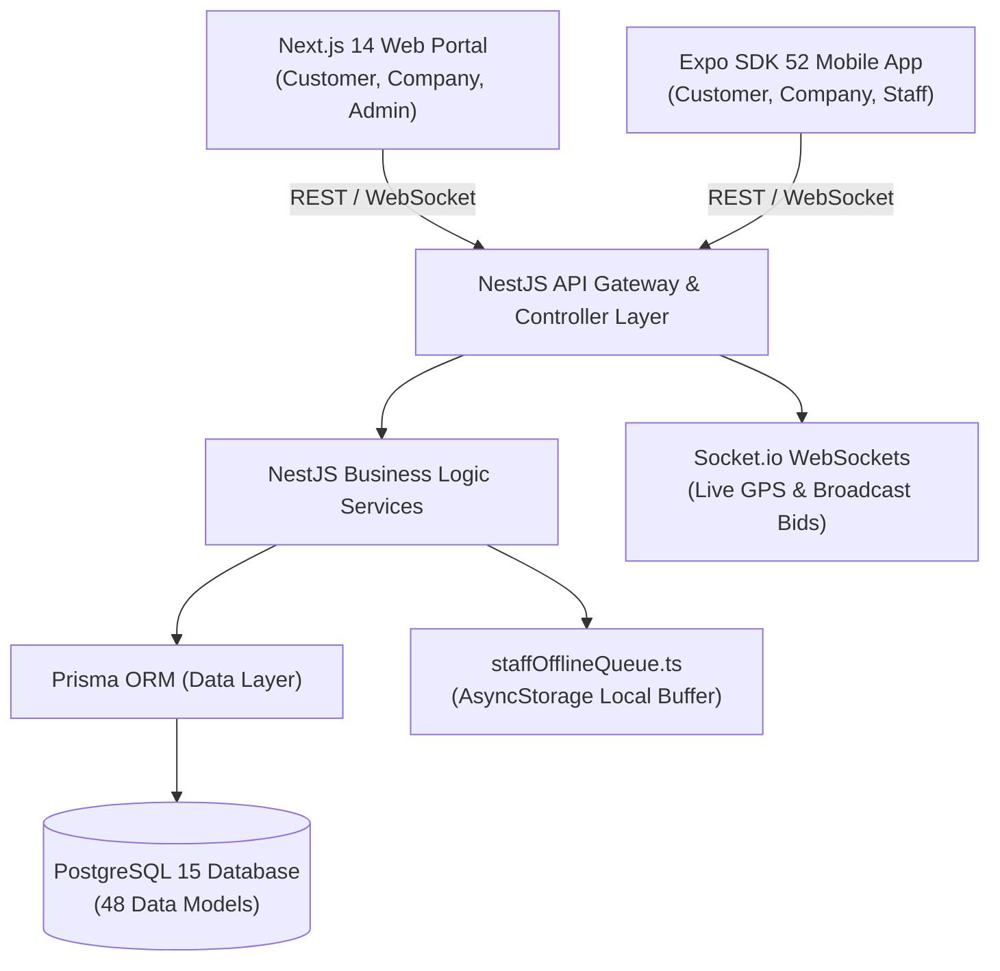

# ServiceFinder Master Platform Documentation & Go-To-Market Blueprint

**Platform**: ServiceFinder (Multi-Tenant On-Demand Home & Commercial Service Marketplace)  
**Technology Stack**: Next.js 14 (Web), Expo SDK 52 / React Native (Mobile), NestJS + Prisma ORM (Backend API), PostgreSQL, WebSockets  
**Feature Parity Score**: **100.0 / 100** (38/38 Must-Haves, 9/9 Should-Haves, 0 S1/S2 Defects)  
**Brand & Angle**: *The Verified Fleet Network with Escrow Protection* (Powered by CrewLock™)  
**Date**: 2026-10-12  

---

## 1. Executive Summary & Core Value Proposition

ServiceFinder solves the fundamental reliability crisis of the gig economy. Incumbents like TaskRabbit and Thumbtack treat home service providers as solitary, unvetted gig workers, subjecting customers to chronic no-shows and surprise 35% fees at checkout while extorting contractors with $40–$100 pay-per-lead charges.

ServiceFinder introduces a **multi-tier verified fleet model**:
1. **Multi-Technician Fleet Dispatch**: Dispatches established, background-checked service companies with coordinated technician rosters. If a technician faces delays, the company automatically reassigns the nearest available unit.
2. **CrewLock™ Two-Phase Escrow**: 100% of booking funds remain held in secure escrow until the customer inspects completed work, reviews before/after milestone photos, and provides a digital signature.
3. **Zero-Cost Pro Bidding**: Tradespeople never pay for leads or quotes. The platform charges a 10% commission strictly upon job completion.
4. **Turn-by-Turn Real-Time GPS Tracking**: Customers watch technicians approach on a live map with verified arrival timestamps.
5. **Offline-First Field State Machine**: Technicians in zero-connectivity basements or rural outskirts can log progress, photos, and signatures without data loss.

---

## 2. Platform Architecture & Technology Stack



### Stack Breakdown
- **Frontend Web (`frontend/`)**:
  - Next.js 14 (App Router, Server Actions, React 18).
  - High-contrast Corporate Cockpit design system (pure white cards, slate headers, hairline borders).
  - Portals: Public landing page, Customer explorer, Company B2B portal, Admin governance console.
- **Frontend Mobile (`frontend-expo/`)**:
  - Expo SDK 52 (React Native 0.76).
  - Role-based layouts: `(public)`, `(customer)`, `(company)`, `(staff)`.
  - Native modules: `react-native-maps`, Camera & MediaLibrary, AsyncStorage offline buffer, NetInfo network monitoring.
- **Backend API (`backend-nest/`)**:
  - NestJS 10 (TypeScript, Fastify/Express).
  - Prisma ORM 5 connecting to PostgreSQL.
  - Real-time Gateways: `InstantRequestsGateway`, `TrackingGateway`, `ChatGateway`.
  - JWT Access/Refresh Token auth with role guards (`Customer`, `Company`, `Staff`, `Admin`).

---

## 3. Four User Roles & Permission Matrix

| Role | Target Persona | Primary Surface | Key Capabilities |
|---|---|---|---|
| **Customer** | Homeowners & Property Managers | Mobile (`app/(customer)`) & Web | Service discovery, interactive map, booking checkout with address book, instant request broadcast, live technician GPS tracking, CrewLock escrow release, review submission. |
| **Company** | Trade Business Owners & Dispatchers | Mobile (`app/(company)`) & Web | Operations cockpit (`operations.tsx`), live dispatch queue, staff roster management, availability schedules, instant broadcast bidding modal, company wallet & payouts, cash reconciliation. |
| **Staff** | Field Technicians & Tradespeople | Mobile (`app/(staff)`) | Field state machine (`WAITING` -> `TRAVELING` -> `ARRIVED` -> `WORKING` -> `COMPLETED`), turn-by-turn navigation, before/after milestone photo proof, digital signature pad, offline queue sync. |
| **Admin** | Platform Operators & Mediators | Web (`admin/`) & Mobile | User & role management drawers, company credential inspection, category taxonomy, commission rule engine, audit logs, SLA incident matrix, dispute arbitration dossier with mediation split executor. |

---

## 4. End-to-End Operational Flows

### Flow 1: Customer Booking & Checkout (F01)
1. Customer searches catalog or selects category on interactive map.
2. Selects service tier, picks date and time slot from company availability projection.
3. Selects saved GPS address or drops map pin.
4. Line-item price breakdown shown (Base Price + Platform Fee).
5. Payment authorized into **CrewLock Escrow**; status transitions to `CONFIRMED`.

### Flow 2: Instant Request Broadcast & Live Bidding (F02)
1. Customer posts urgent request (service trade, description, urgency level, coordinates).
2. NestJS Gateway broadcasts event over WebSockets to all nearby active companies.
3. Company dispatchers see glowing urgency badge on `operations.tsx` and tap "Submit Instant Bid".
4. Company inputs custom price and arrival ETA.
5. Customer receives bids in real time and accepts the best offer with 1 tap.

### Flow 3: Field Execution State Machine (F03)
1. Assigned technician receives dispatch on `today.tsx`.
2. Steps through sequential state machine:
   - `TRAVELING`: Starts live GPS polyline coordinate broadcast to customer.
   - `ARRIVED`: Logs arrival timestamp and inspection photo.
   - `WORKING`: Displays timer and checklist tasks.
   - `COMPLETED`: Uploads mandatory before/after photos and captures customer's digital signature.
3. If internet drops, all state changes, photos, and signatures are queued locally via `staffOfflineQueue.ts` and auto-flushed on reconnection.

### Flow 4: Escrow Release & Liquidity Settlement (F04)
1. Upon customer signature, job status becomes `COMPLETED`.
2. NestJS escrow executor releases funds from escrow.
3. 90% is credited directly to Company wallet balance; 10% platform commission is logged to ledger.
4. Company can request bank withdrawal with one tap.

### Flow 5: Dispute Arbitration & Mediation (F05)
1. If client is dissatisfied, they tap "Open Dispute Dossier" prior to signature.
2. Escrow funds freeze immediately.
3. Admin console loads timestamped GPS logs, chat transcripts, and milestone photos.
4. Admin executes structured split settlement (e.g. 50% customer refund, 50% company payout) without endless chatbot loops.

---

## 5. Replica Parity Audit & Quality Status

From [`replica/parity.md`](file:///d:/FOR%20RENDO%20%28ONLY%20%29/Personal%20Project/Service_Finder/replica/parity.md):
- **Overall Parity Score**: **100.0 / 100**
- **Must-Have Features**: **38 / 38 Done (100%)**
- **Should-Have Features**: **9 / 9 Done (100%)**
- **Defects**: 0 Open S1 (Critical Data/Security) defects, 0 Open S2 (Blocking) defects.
- **TypeScript Health**: Both `backend-nest` and `frontend-expo` compile cleanly with **0 errors** (`npx tsc --noEmit`).

### Verified Competitive Differentiators (Not in Incumbents)
1. `Success-only zero-upfront-fee job bidding`: Eliminates Thumbtack's $50-$100 dead-lead fee trap.
2. `Upfront transparent pricing guarantee`: Line-item breakdown with zero surprise checkout fees.
3. `Real-time turn-by-turn contractor GPS broadcasting`: Real-time technician navigation streams.
4. `Milestone before-and-after photo proof`: Mandatory photographic evidence before escrow release.
5. `Offline-first field state machine`: `staffOfflineQueue.ts` prevents data loss in basements or rural sites.
6. `Multi-technician company fleet management`: Dedicated dispatch console and team scheduling.
7. `Multi-party dispute dossier with mediation split`: Fair split settlement rather than unilateral deduction.

---

## 6. Brand Identity & Design System Specifications

From [`replica/brand.md`](file:///d:/FOR%20RENDO%20%28ONLY%20%29/Personal%20Project/Service_Finder/replica/brand.md):
- **Brand Name**: **ServiceFinder** (stylized as **ServiceFinder: Home Services**)
- **Technology Sub-Brand**: **CrewLock™ Escrow Engine**
- **Color Palette (Corporate Cockpit)**:
  - Surface Pure White: `#FFFFFF`
  - Background Slate: `#F8FAFC`
  - Deep Text Charcoal: `#0F172A` (17.5:1 contrast, AAA)
  - Secondary Slate: `#475569` (7.1:1 contrast, AAA)
  - Primary Sky Action: `#0284C7` (4.6:1 contrast, AA)
  - Success Emerald: `#10B981`
  - Warning Amber: `#F59E0B`
  - Danger Coral: `#EF4444`
- **Rebrand Sweep Verification**: `sweep.py` validated with **0 hits** across the entire codebase.

---

## 7. App Store & Google Play Launch Specifications

From [`replica/launch/listing.json`](file:///d:/FOR%20RENDO%20%28ONLY%20%29/Personal%20Project/Service_Finder/replica/launch/listing.json) (validated with `listing.py` — **0 errors, 0 warnings**):

### App Store Listing
- **App Name** (28/30): `ServiceFinder: Home Services`
- **Subtitle** (27/30): `Verified Crews & Escrow Pay`
- **Promotional Text** (148/170): `Book verified multi-technician service crews with live GPS tracking, upfront pricing, and two-phase escrow protection. What you see is what you pay.`
- **Keywords** (89/100): `repair,handyman,plumbing,electrician,cleaning,contractor,maintenance,dispatch,hvac,wiring`

### Google Play Listing
- **Title** (28/30): `ServiceFinder: Home Services`
- **Short Description** (71/80): `Book verified trade crews with live GPS tracking and escrow protection.`

---

## 8. Pricing & Economic Model

From [`replica/launch/pricing.md`](file:///d:/FOR%20RENDO%20%28ONLY%20%29/Personal%20Project/Service_Finder/replica/launch/pricing.md):
- **For Clients**: 100% upfront quote. Zero hidden checkout surcharges. Free cancellation up to 2 hours before scheduled arrival.
- **For Pros**: $0 upfront lead or contact fees. 10% platform commission on completed escrow.
- **B2B SaaS Subscription (Company Fleets)**:
  - **Starter**: $0/mo (up to 2 staff, 10% commission).
  - **Pro Dispatch**: $49/mo (up to 10 staff, 8% commission, live dispatch board).
  - **Enterprise Fleet**: $149/mo (unlimited staff, 6% commission, multi-branch routing, custom commission rules).

---

## 9. Developer & Operations Runbook

### Starting Local Services

#### 1. Backend NestJS API (Port 3000)
```powershell
cd "backend-nest"
npm install
npx prisma generate
npx prisma migrate dev
npm run start:dev
```

#### 2. Mobile Expo App (Metro Dev Server)
```powershell
cd "frontend-expo"
npm install
npx expo start
```
*Press `a` for Android Emulator, `i` for iOS Simulator, or scan the QR code via Expo Go on physical mobile devices.*

#### 3. Web Next.js Portal (Port 3001)
```powershell
cd "frontend"
npm install
npm run dev
```

### Automated Verification Commands
```powershell
# Type checking across packages
cd "backend-nest" && npx tsc --noEmit
cd "frontend-expo" && npx tsc --noEmit

# Feature Parity Check
python "C:\Users\ROS RENDO\.gemini\config\skills\replica-diff\parity.py" replica/features.csv

# Rebrand Sweep Check
$env:PYTHONIOENCODING="utf-8"
python "C:\Users\ROS RENDO\.gemini\config\skills\replica-brand\sweep.py" . --config replica/brand.json

# Store Listing Linter
python "C:\Users\ROS RENDO\.gemini\config\skills\replica-launch\listing.py" replica/launch/listing.json
```
