# 🏛️ Marketplace Admin Portal — Operations & Compliance Blueprint

This blueprint outlines the visual navigation structure and detailed marketplace operator features of the Admin Portal in ServiceFinder.

---

## 🧭 Locked Navigation Structure

```mermaid
graph TD
    %% Sidebar Navigation Groups
    Sidebar[AppSidebar] --> Overview[🏠 Overview]
    Sidebar --> TrustSafety[⚖️ Trust & Safety]
    Sidebar --> Marketplace[👥 Marketplace]
    Sidebar --> CatalogGrowth[🛠️ Catalog & Growth]
    Sidebar --> Finance[💰 Finance]
    Sidebar --> Platform[⚙️ Platform]

    %% Overview Subpages
    Overview --> Dash[Dashboard]
    Overview --> Anal[Analytics]
    Overview --> Reports[Reports]

    %% Trust & Safety Subpages
    TrustSafety --> Verify[Verification Queue ⭐]
    TrustSafety --> Disputes[Disputes]
    TrustSafety --> Fraud[Fraud Monitoring]
    TrustSafety --> Support[Support Desk]

    %% Marketplace Subpages
    Marketplace --> Companies[Companies]
    Marketplace --> Users[Users]
    Marketplace --> Staff[Staff]
    Marketplace --> Bookings[Bookings]
    Marketplace --> ServiceAreas[Service Areas]

    %% Catalog & Growth Subpages
    CatalogGrowth --> Categories[Categories]
    CatalogGrowth --> SvcTypes[Service Types]
    CatalogGrowth --> Campaigns[Campaigns]
    CatalogGrowth --> Promos[Promo Codes]
    CatalogGrowth --> Featured[Featured Listings]

    %% Finance Subpages
    Finance --> Revenue[Platform Revenue]
    Finance --> Payouts[Payouts]
    Finance --> Ledger[Transactions Ledger]
    Finance --> Refunds[Refunds]

    %% Platform Subpages
    Platform --> AIEngine[Dispatch Engine]
    Platform --> Integrations[Integrations]
    Platform --> AuditLogs[Audit Logs]
    Platform --> System[System Settings]
```

---

## 💎 Operational Feature Details

### 🏠 1. Overview Group

#### Dashboard
*   **Live Marketplace Health View**: Displays active, real-time metrics of operations to catch matching gaps or market failures:
    *   `🟢 Active Jobs`: 245
    *   `🚗 Staff Traveling`: 72
    *   `🔴 Unassigned Jobs`: 12
    *   `🏢 Online Companies`: 85
    *   `👥 Online Staff`: 430
*   **Marketplace Earnings KPI Summary**: Real-time revenue split totals, verification queues.

#### Analytics
*   *Features*: Composed line graphs showing customer-to-merchant volume, average transaction growth, and registrations.

#### Reports
*   *Features*: Financial and operational reporting logs, CSV exports.

---

### ⚖️ 2. Trust & Safety

#### Verification Queue ⭐ *(Compliance Gateway)*
*   **Verification Gates**: Standard verification lifecycle states for companies:
    *   `Pending Verification` ➡️ `Active/Verified` ➡️ `Suspended` ➡️ `Blocked` ➡️ `Inactive`
*   **Compliance Upload Checks**: Vets Business License, Insurance certificates, and tax registration documents.

#### Disputes
*   **Mediation Panel**: Compares Customer Claim Details (photos, text) against Company Counter-Evidence (before/after photos, worker GPS timestamp logs, completed checklist steps, and customer signature).
*   **Mediation Actions**: Release Escrow, Issue Full/Partial Refund, or Custom splits.

#### Fraud Monitoring
*   **Heuristics Check**: Flags abnormal refund ratios, high company cancel rates, duplicate/sybil accounts, and review manipulations.

#### Support Desk
*   **Features**: Mediate custom user problems.

---

### 👥 3. Marketplace

#### Companies, Users, & Staff Directories
*   **Profile Controls**: Suspend/Lock profiles, review transaction counts, and manage coverage bounds.

#### Bookings Master (Controlled Actions)
*   **Operator Actions**:
    *   `Allowed`: View, Refund, Cancel abusive jobs, Mediate disputes, Audit timeline logs.
    *   `Restricted`: Edit prices, manually assign random staff, modify booking metadata.

#### Service Areas
*   **Regional Expansion Control**: Enable service category access per territory (e.g. Phnom Penh: Cleaning ✅, HVAC ✅ | Siem Reap: Cleaning ✅, Plumbing ❌).

---

### 🛠️ 4. Catalog & Growth

#### Categories & Service Types
*   **Features**: Global categories CRUD. Set base template price ranges and default on-site checklists per service package (Basic, Standard, Premium).

#### Campaigns, Promo Codes, & Featured Listings
*   **Features**: Setup homepage sliders, featured company sponsorships, push alert campaigns, and discount codes.

---

### 💰 5. Finance

#### Platform Revenue & Payouts
*   **Payout Controls**: Authorize company cashouts via KHQR scan.
*   **Transactions Ledger**: Immutable platform double-entry financial ledger log.
*   **Refunds**: MEDIATION refund issue workspace.

---

### ⚙️ 6. Platform Settings

#### Dispatch Engine
*   **Rules Slider**: Setup search radius bounds (e.g. 5km) and matching priority percentage weights:
    *   `Skill Match` (50%) | `Distance` (30%) | `Rating` (20%)

#### Integrations
*   **Configuration**:
    *   *Payments*: ABA PayWay, KHQR, Stripe.
    *   *Maps*: Google Maps API, OpenStreetMap.
    *   *Alerts*: Twilio SMS, Firebase Push Notifications.

#### Audit Logs & System Settings
*   **Features**: Backups and security login history.
