# 🚀 Upgraded B2B SaaS Company Portal — Navigation & Feature Blueprint

This blueprint outlines the final locked navigation layout, visual widgets, and functional requirements of the ServiceFinder B2B SaaS Portal.

---

## 🧭 Locked Navigation Structure

```mermaid
graph TD
    %% Sidebar Navigation Groups
    Sidebar[AppSidebar] --> Overview[🏠 Overview]
    Sidebar --> Operations[⚡ Operations]
    Sidebar --> Business[🏢 Business]
    Sidebar --> Finance[💰 Finance]
    Sidebar --> Settings[⚙️ Settings]

    %% Overview Subpages
    Overview --> Dash[Dashboard]
    Overview --> Anal[Analytics]
    Overview --> Notif[Notifications]

    %% Operations Subpages
    Operations --> Dispatch[Dispatch Center ⭐]
    Operations --> Bookings[Bookings]
    Operations --> Staff[Staff]
    Operations --> Schedule[Schedule]

    %% Business Subpages
    Business --> Services[Services]
    Business --> Customers[Customers]
    Business --> Reviews[Reviews]
    Business --> Disputes[Disputes]

    %% Finance Subpages
    Finance --> Wallet[Wallet]
    Finance --> Transactions[Transactions]
    Finance --> Revenue[Revenue]
    Finance --> CommRules[Commission Rules]
    Finance --> Payouts[Payouts]

    %% Settings Subpages
    Settings --> Profile[Company Profile]
    Settings --> Verification[Verification]
    Settings --> TeamPerms[Team Permissions]
    Settings --> DispRules[Dispatch Rules]
    Settings --> System[System]
```

---

## 💎 Expanded Feature Blueprints

### ⚡ 1. Operations & Dispatch

#### A. Dispatch Center ⭐ *(Operational Command)*
*   **Split Pane Map Workload**:
    *   `🟢 Staff pins`: Includes current status (Online/Idle vs Busy), current job assignment details, average completion times, and total jobs completed today (e.g. `John: 3 jobs completed, Available`).
    *   `🚗 Traveling staff`: ETA countdowns and pathing overlays.
    *   `🔴 Job pins`: Hover displays urgency priority (Emergency, Same Day, Scheduled) and target booking address.
*   **Unassigned Jobs list**: Unified query supporting manual allocation or triggerable `[Auto Match]`.

#### B. Bookings Queue
*   **Priority Markers**: Urgency status badges displayed next to scheduled slot times:
    *   `🔴 Emergency` (e.g., HVAC failure on a hot day)
    *   `🟠 Same Day` (Requests placed within 24 hours of booking window)
    *   `🟢 Scheduled` (Booked in advance)
*   **Extended Tabs**: Partitioned slots for `All`, `Pending`, `Need Assignment` 🔴, `Assigned`, `In Progress`, `Completed`, `Cancelled`.

#### C. Staff Management (Status & Skills Partitioning)
*   **Filters**: Available Now, Working, Offline, On Leave, Suspended.
*   **Matching Attributes**:
    *   `Skills`: Tag list (e.g. HVAC, Electrical).
    *   `Qualifications`: Specific Service Categories they can claim.
    *   `Availability & Capacity`: Day calendars with weekly workloads.

---

### 🏢 2. Business & Services

#### A. Service Package Matrix
*   **Flexible Offerings**: Each service supports pricing matrices containing Basic, Standard, and Premium packages.
*   **Attributes per Package**:
    *   `Price` & `Duration`
    *   `Required Skills` (e.g., HVAC required for Premium maintenance)
    *   `Checklist steps` (e.g., ☐ Inspect unit, ☐ Clean filter, ☐ Customer confirmation) which hook directly into the worker's mobile application execution loop.

#### B. Dispute Management
*   **CRM Linkages**: Unifies disputes, tickets, and customer refund claims.
*   **Proof Submission**: Upload before/after photos, completed checklists, and staff notes to resolve complaints.

---

### 💰 3. Finance & Splits

#### A. Commission Rules
*   **Split Adjustments**: Control over platform and staff payouts:
    *   *Service price*: $50
    *   *ServiceFinder platform fee*: 10% ($5)
    *   *Company share*: $45
    *   *Worker payout split*: Adjustable percentage (e.g. 60% of company earnings ➡️ $27 paid to staff wallet).

#### B. Wallet (Escrow vs Available Cash)
*   Displays available company funds vs pending completed job funds (locked in active escrows).

---

### ⚙️ 4. Settings & Permissions

#### A. Dispatch Rules
*   **Modes Selection**: Toggle between `Manual Queueing` (managers allocate jobs) and `Auto Match` (automatic system matching).
*   **Matching Priorities**: Configurable rules sorting candidates by:
    1. Skill Match
    2. Distance
    3. Rating
    4. Availability
    5. Workload

#### B. Team Permissions (RBAC)
*   `Owner`: Master access (Wallet, payouts, and company setup).
*   `Manager`: Operations, schedule adjustments, and staff.
*   `Dispatcher`: Dispatch map and bookings queue.
*   `Finance`: Wallet, revenue analytics, and commission setups.
