# 📱 Mobile App Directory & Route Map (All Roles)

This document maps out the complete Expo Router structure and interactive user workflows for the ServiceFinder mobile application (`frontend-expo`), catalogued by role-based workspaces.

---

## 🗺️ Role-Based Mobile Architecture

```mermaid
graph TD
    App[frontend-expo/app] --> Public[(public)]
    App --> Customer[(customer)]
    App --> Staff[(staff)]
    App --> Company[(company)]
    App --> Admin[(admin)]

    %% Customer tab structure
    Customer --> CustTabs[Customer Tabs]
    CustTabs --> CHome[home.tsx]
    CustTabs --> CExplore[explore.tsx]
    CustTabs --> CAct[activity.tsx]
    CustTabs --> CMsg[message.tsx]
    CustTabs --> CProf[profile.tsx]

    %% Staff tab structure
    Staff --> StaffTabs[Staff Tabs]
    StaffTabs --> SToday[today.tsx]
    StaffTabs --> SMoney[money.tsx]
    StaffTabs --> SMe[me.tsx]

    %% Company tab structure
    Company --> CompTabs[Company Tabs]
    CompTabs --> CDash[dashboard.tsx]
    CompTabs --> COps[operations.tsx]
    CompTabs --> CStaff[staff.tsx]
    CompTabs --> CMsg2[messages.tsx]
    CompTabs --> CMore[more.tsx]

    %% Admin tab structure
    Admin --> AdminTabs[Admin Tabs]
    AdminTabs --> ADash[dashboard.tsx]
    AdminTabs --> AQueue[queue.tsx]
    AdminTabs --> AComp[companies.tsx]
    AdminTabs --> AUser[users.tsx]
    AdminTabs --> AAnal[analytics.tsx]
    AdminTabs --> ASettings[settings.tsx]
```

---

## 🧭 Mobile Flow Matrix

All role workspaces are divided into specific tab-panels, sidebar navigators, and dynamic flow subpages:

| Group | Component Name | File Path | Layout Archetype | Actions & Flows | Status |
| :--- | :--- | :--- | :--- | :--- | :--- |
| **Public** | Welcome Page | `(public)/welcome` | Intro Slider | Role introduction screens. Taps to login or signup. | 🟢 Clean |
| | Login Screen | `(public)/login` | Form Layout | Requests OTP SMS verify, shifts verification numeric input keys. | 🟢 Clean |
| | Register Screen | `(public)/register` | Form Layout | Takes profile inputs. Role selections checkboxes. | 🟢 Clean |
| **Customer** | tabs/home | `(customer)/(tabs)/home` | Grid Tab Panel | Home catalog. Banners shortcuts to categories or emergency matches. | 🟢 Clean |
| | tabs/explore | `(customer)/(tabs)/explore` | Directory search map | Category lookup. Toggles map displaying nearby merchant markers. | 🟢 Clean |
| | tabs/activity | `(customer)/(tabs)/activity` | Cards list view | Active stepper matching tracking cards list. Taps route to tracker/[id]. | 🟢 Clean |
| | tabs/message | `(customer)/(tabs)/message` | Chat List | Chat threads index list. Redirects to room message chat window. | 🟢 Clean |
| | tabs/profile | `(customer)/(tabs)/profile` | Grid settings list | Edit profile, address book configurations, credits balances. | 🟢 Clean |
| | Search Page | `(customer)/search` | Directory list | Autocomplete search cards. Filter modifiers checklist. | 🟢 Clean |
| | Company Details | `(customer)/company` | Split Header Tabs | Company bio, rating scorecards, review comments lists, services. | 🟢 Clean |
| | Service Details | `(customer)/service` | Stepper details | Comparison matrices tiers (Basic, Standard, Premium). scheduled slot calendar. | 🟢 Clean |
| | Checkout Escrow | `(customer)/checkout` | Form Layout | Split billings invoice calculations. Stripe/Bakong pay gateways. | 🟢 Clean |
| | ASAP matching | `(customer)/instant-request` | Radar animation | Radar matching scan coordinate grids for incoming company bids. | 🟢 Clean |
| | Booking Tracker | `(customer)/booking/[id]` | Split map details | Live coordinates path tracking of technician en route map. steppers checks. | 🟢 Clean |
| | Booking Cancel | `(customer)/booking/cancel` | Form Layout | Penalty fee structures calculations. Cancelling completes transaction reversal. | 🟢 Clean |
| | Review Job | `(customer)/reviews` | Form Layout | Star rating index clicks. Camera upload before/after photos. | 🟢 Clean |
| **Staff** | tabs/today | `(staff)/(tabs)/today` | Split map details | Maps technician path coordinates. Steppers to Accepted ➡️ En Route. | 🟢 Clean |
| | tabs/money | `(staff)/(tabs)/money` | Split Header dashboard | Disbursable balance cards. Withdrawal history list logs. | 🟢 Clean |
| | tabs/me | `(staff)/(tabs)/me` | Grid settings list | Online status toggle switch. Shifts hours details. | 🟢 Clean |
| | Job Details | `(staff)/job/[id]/index` | Stepper details | Active technician task details. Customer address and dispatch notes. | 🟢 Clean |
| | Job Execution | `(staff)/job/[id]/execution` | Stepper details | Job checklist execution list. Cameras uploads required photo proof. | 🟢 Clean |
| | Job Completion | `(staff)/job/[id]/complete` | Signature Drawing | Signature canvas drawing pad. Completion completes escrow payouts split. | 🟢 Clean |
| | Staff Payouts | `(staff)/payout` | Form Layout | Payout request form. Uploads bank settlement KHQR scan. | 🟢 Clean |
| | Availability Calendar | `(staff)/availability` | Tabs Grid | Sidebar tool: Configures weekly hours slots and availability calendar. | 🟢 Clean |
| | Staff Time Off | `(staff)/timeoff` | Form Layout | Sidebar tool: Submits vacation and leave requests. | 🟢 Clean |
| | Staff Performance | `(staff)/performance` | Split Header | Sidebar tool: Audits ratings, average check-ins and performance. | 🟢 Clean |
| **Company** | tabs/dashboard | `(company)/(tabs)/dashboard` | Grid tab panel | Performance metrics overview. Daily sales and matching alerts cards. | 🟢 Clean |
| | tabs/operations | `(company)/(tabs)/operations` | Directory list | Active bookings dispatch list. manual worker allocation selects. | 🟢 Clean |
| | tabs/staff | `(company)/(tabs)/staff` | Directory list | Staff list showing certificates verification state checkmarks. | 🟢 Clean |
| | Service Coverage | `(company)/coverage` | Custom Leaflet Map | Coverage map. Slider sets matching radius bounds circles. | 🟢 Clean |
| | Services Catalog | `(company)/services` | Directory list | subcategory packages tiers pricing config forms. | 🟢 Clean |
| | Open Bid Jobs | `(company)/available-jobs` | Directory list | Sidebar B2B Command center to bid for emergency bookings. | 🟢 Clean |
| | Company Settings | `(company)/settings` | Tabs config form | Sidebar tool: Configure company name, business hours, and cover logo. | 🟢 Clean |
| | SaaS Subscription | `(company)/subscription` | Form Layout | Sidebar tool: Verify active subscription status (Trial vs Pro). | 🟢 Clean |
| | Company Support | `(company)/support` | Directory list | Sidebar B2B Help desk to file technical tickets. | 🟢 Clean |
| | Withdraw Balance | `(company)/payouts/request` | Form Layout | Sidebar payout requests. Uploads Bakong settlement QR scan code. | 🟢 Clean |
| **Admin** | tabs/dashboard | `(admin)/(tabs)/dashboard` | Tab Grid View | Mobile admin stats grid mapping active matches counts. | 🟢 Clean |
| | tabs/queue | `(admin)/(tabs)/queue` | Lists View | Lists pending merchant verifications queue. Taps verify. | 🟢 Clean |
| | System Monitoring | `(admin)/monitoring` | Split Header | Sidebar tool: Audits live checkouts and server actions list. | 🟢 Clean |
| | Audit Trail Log | `(admin)/audit` | Directory list | Sidebar tool: Immutable system action audit logs tracker. | 🟢 Clean |
| | Compliance Vetting | `(admin)/compliance` | Directory list | Sidebar tool: Approves or rejects B2B document certifications. | 🟢 Clean |
| | Push Broadcasts | `(admin)/broadcasts` | Form Layout | Sidebar tool: Form to compose push alerts to select role targets. | 🟢 Clean |
| | Disputes Mediation | `(admin)/disputes` | Directory list | Sidebar tool: Lists customer disputes. routes disputes/[id] details. | 🟢 Clean |
| | KHQR payouts | `(admin)/payouts` | Directory list | Sidebar tool: Approves pending withdrawals by reviewing KHQR scans. | 🟢 Clean |
