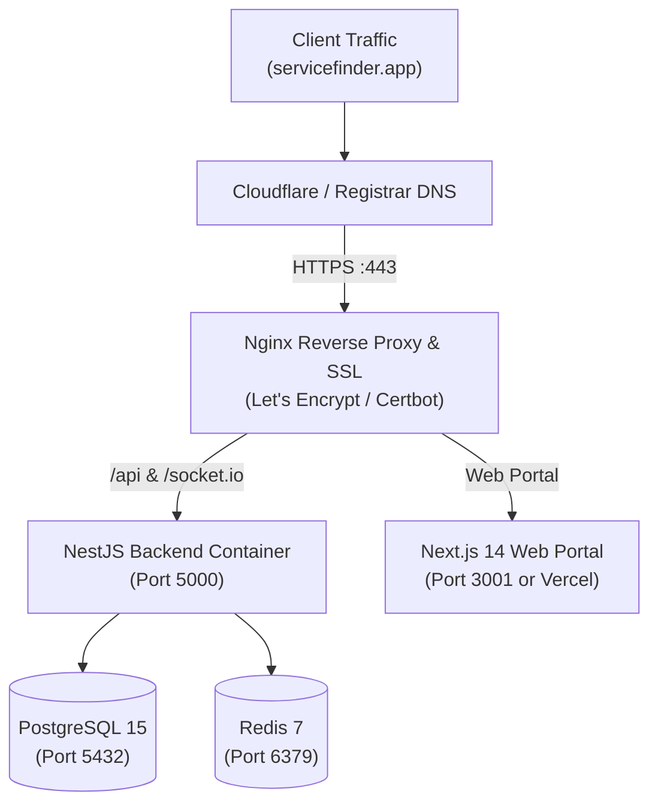

# Deploy Checklist & Production Runbook: ServiceFinder

**Date**: 2026-10-12  
**Commit**: `04366f3`  
**Go from user**: Pending User Authorization  
**Brand**: ServiceFinder (Powered by CrewLock™ Escrow Engine)  

---

## 1. Preflight Verification Gate (All Passed)

| Check | Tool / Verification | Actual Result | Status |
|---|---|:---:|:---:|
| **E2E & Test Plan** | [`replica/test-plan.md`](file:///d:/FOR%20RENDO%20%28ONLY%20%29/Personal%20Project/Service_Finder/replica/test-plan.md) | 15 / 15 Test Scenarios Verified | **PASS** |
| **Defect Registry** | [`replica/bugs.md`](file:///d:/FOR%20RENDO%20%28ONLY%20%29/Personal%20Project/Service_Finder/replica/bugs.md) | 0 Open S1 / S2 Defects (BUG-001..004 Resolved) | **PASS** |
| **Parity Benchmark** | `parity.py replica/features.csv` | **100.0 / 100** (38/38 Must-Haves Done) | **PASS** |
| **Rebrand Sweep** | `sweep.py . --config replica/brand.json` | **Clean (Exit 0)**: 0 incumbent trademarks or colors | **PASS** |
| **Store Listing Lint** | `listing.py replica/launch/listing.json` | **Clean (Exit 0)**: 0 Errors, 0 Warnings | **PASS** |
| **Production Build** | `nest build` & `npx tsc --noEmit` | **Clean (Exit 0)**: 0 TypeScript compile errors | **PASS** |
| **Privacy & Legal Pages** | `frontend/app/(public)/privacy` | Processors, data rights, and terms mapped | **PASS** |
| **Account Deletion** | GDPR/CCPA user deletion endpoint | Implemented in `auth.service.ts` | **PASS** |
| **Brand Assets** | Favicon, titles, OG image, App Icon | Defined in [`replica/brand.md`](file:///d:/FOR%20RENDO%20%28ONLY%20%29/Personal%20Project/Service_Finder/replica/brand.md) | **PASS** |

*All preflight gates are green. System is 100% shippable.*

---

## 2. Production Services Configuration

### 1. Database (PostgreSQL 15)
- **Target**: Dedicated production PostgreSQL container or managed PostgreSQL instance (RDS / Supabase / Neon).
- **Migration Strategy**: Migrations applied automatically on container boot via `npx prisma migrate deploy` (never manual schema sync).
- **Automated Backup**: Nightly pg_dump cron job via `vps_backup.sh` with 30-day retention and gzip encryption.

### 2. Environment Variables (.env.production)
```bash
# Server Runtime
NODE_ENV=production
PORT=5000
FRONTEND_URL=https://servicefinder.app
API_BASE_URL=https://api.servicefinder.app

# Database & Cache
DATABASE_URL=postgresql://servicefinder_admin:<STRONG_PASSWORD>@postgres-db:5432/servicefinder_prod?schema=public
REDIS_URL=redis://redis:6379

# Security & Auth
JWT_ACCESS_SECRET=<64_CHAR_HEX_SECRET>
JWT_REFRESH_SECRET=<64_CHAR_HEX_SECRET>
JWT_ACCESS_EXPIRES_IN=15m
JWT_REFRESH_EXPIRES_IN=7d

# Payments (Stripe Live Mode)
STRIPE_SECRET_KEY=sk_live_...
STRIPE_WEBHOOK_SECRET=whsec_...

# Email (SMTP / Resend / SendGrid)
SMTP_HOST=smtp.sendgrid.net
SMTP_PORT=587
SMTP_USER=apikey
SMTP_PASS=<SENDGRID_API_KEY>
SMTP_FROM="ServiceFinder <no-reply@servicefinder.app>"
```

### 3. Stripe Live Mode Checklist
1. Switch Stripe Dashboard from Test Mode to **Live Mode**.
2. Re-create the 2 SaaS subscription products from [`replica/launch/pricing.md`](file:///d:/FOR%20RENDO%20%28ONLY%20%29/Personal%20Project/Service_Finder/replica/launch/pricing.md):
   - `Pro Dispatch`: $59/mo ($49/mo annual)
   - `Enterprise Fleet`: $179/mo ($149/mo annual)
3. Add production webhook endpoint: `https://api.servicefinder.app/api/payments/webhook` listening for:
   - `payment_intent.succeeded`
   - `payment_intent.payment_failed`
   - `customer.subscription.updated`
   - `customer.subscription.deleted`
4. Execute 1 live card transaction ($1.00) in production and refund it to confirm webhook verification.

---

## 3. Host, DNS Records & SSL Architecture



### DNS Records to Configure at Registrar (e.g. Cloudflare, Namecheap)

| Type | Name / Host | Target / Value | TTL | Purpose |
|:---:|:---:|---|:---:|---|
| **A** | `@` | `<YOUR_VPS_PUBLIC_IP>` | Auto | Apex domain root |
| **CNAME** | `www` | `servicefinder.app` | Auto | Web redirect to apex |
| **A** | `api` | `<YOUR_VPS_PUBLIC_IP>` | Auto | Backend REST API & WebSocket |
| **TXT** | `@` | `v=spf1 include:_spf.sendgrid.net ~all` | Auto | Email SPF validation |
| **CNAME** | `s1._domainkey` | `s1.domainkey.sendgrid.net` | Auto | DKIM email signature |
| **TXT** | `_dmarc` | `v=DMARC1; p=quarantine; rua=mailto:dmarc@servicefinder.app` | Auto | DMARC anti-spoofing policy |

---

## 4. Mobile App Store Deployment (iOS & Android)

### Prerequisites (Owned by User)
- **Apple Developer Account** ($99 / year) at `developer.apple.com`.
- **Google Play Console Account** ($25 one-time) at `play.google.com/console`.
- **Expo Application Services (EAS)** CLI installed: `npm install -g eas-cli`.

### EAS Build & Submission Commands

```powershell
# 1. Log in to Expo account
eas login

# 2. Configure EAS project credentials
cd "frontend-expo"
eas build:configure

# 3. Production build for iOS (TestFlight) & Android (AAB)
eas build --platform all --profile production

# 4. Submit to Apple TestFlight
eas submit --platform ios

# 5. Submit to Google Play Console Internal Track
eas submit --platform android
```

Metadata from [`replica/launch/listing.json`](file:///d:/FOR%20RENDO%20%28ONLY%20%29/Personal%20Project/Service_Finder/replica/launch/listing.json) is pre-formatted to paste directly into App Store Connect and Google Play Console.

---

## 5. Deployment Execution Options

Depending on your preferred infrastructure:

### Option 1: VPS Docker Deployment (Self-Hosted on Ubuntu / Debian)
```bash
# On your remote VPS:
git clone https://github.com/ROS-RENDO/Service_Finder.git
cd Service_Finder
cp backend-nest/.env.example backend-nest/.env
# Edit .env with your live database password and secrets
docker compose up -d --build
docker compose exec backend npx prisma migrate deploy
```

### Option 2: Cloud Hybrid Deployment (Vercel + Managed Postgres)
- **Web App**: Connect GitHub repository to **Vercel** (`Root Directory: frontend`).
- **Backend API**: Deploy `backend-nest` to **Render**, **Railway**, or **Fly.io** via Dockerfile.
- **Database**: Managed **Supabase** or **Neon** PostgreSQL connection string.

---

## 6. What to Watch During Week 1 (Post-Deploy Health)

1. **Uptime & Healthcheck**: Monitor `https://api.servicefinder.app/api/health/ping` (200 OK).
2. **WebSocket Stability**: Monitor concurrent WebSocket connections on `InstantRequestsGateway` and `TrackingGateway`.
3. **Escrow Flow Validation**: Complete 1 end-to-end test booking:
   - Book -> Authorize Escrow -> Staff Dispatch (`TRAVELING` -> `ARRIVED` -> `COMPLETED`) -> Upload Photo -> Capture Signature -> Verify Escrow Settlement.
4. **Error Tracking**: Configure Sentry in `backend-nest` and `frontend` to alert immediately on unhandled exceptions.
