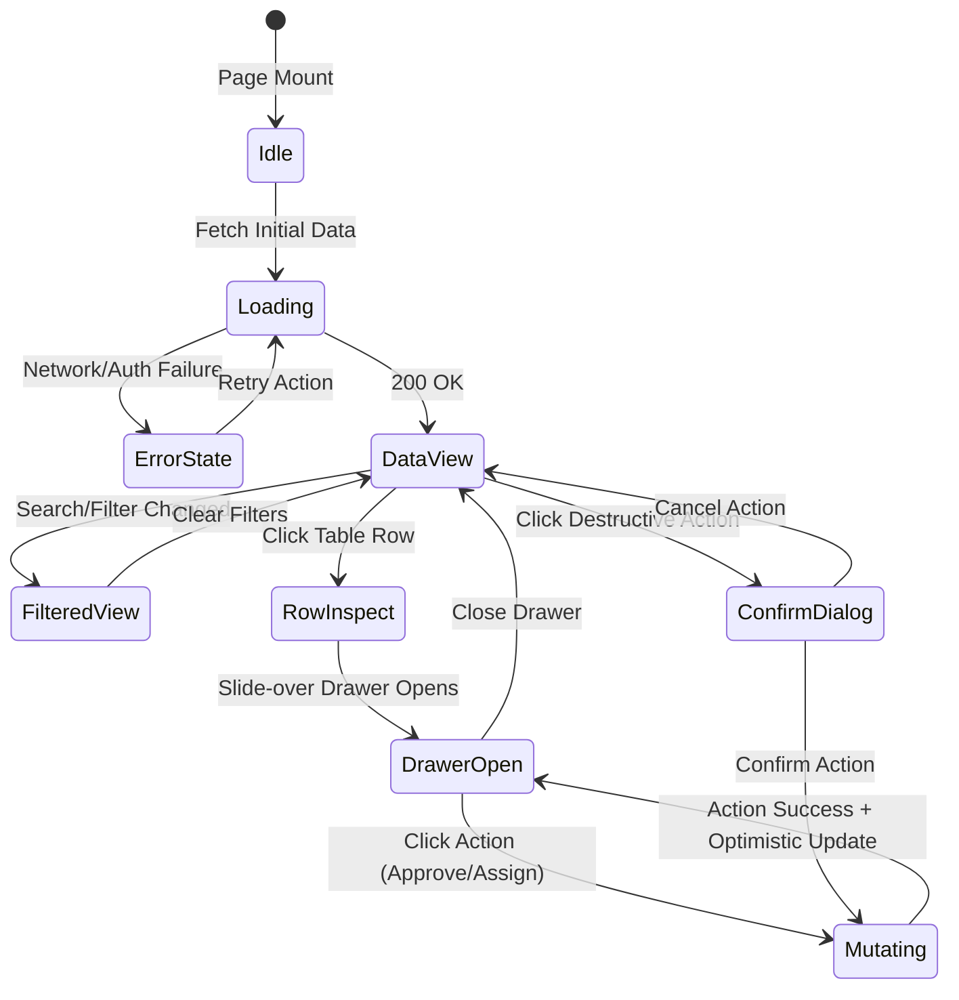

# UI Data Model & State Architecture: Clean Management UI

**Feature**: Clean Management UI (Company & Admin Refit)  
**Spec**: [spec.md](./spec.md)  
**Date**: 2026-09-25  

---

## 1. Overview

This document specifies the UI view-models, state containers, filter criteria, and component data representations used across the redesigned Company and Admin management surfaces (Next.js web portal and Expo mobile app).

---

## 2. Core UI View-Models

### 2.1 Management Table View-Model (`DataGridState<T>`)
Used by all operational lists (Bookings, Companies, Staff, Verification, Disputes, Transactions, Payouts).

```typescript
export interface DataGridState<T> {
  // Data payload
  items: T[];
  totalCount: number;
  isLoading: boolean;
  isError: boolean;
  errorMessage?: string;

  // Pagination
  pagination: {
    pageIndex: number;      // 0-indexed
    pageSize: number;       // default: 25, options: [10, 25, 50, 100]
    pageCount: number;
  };

  // Sorting
  sorting: {
    columnId: keyof T | string;
    direction: 'asc' | 'desc';
  }[];

  // Global & column filters
  searchQuery: string;      // debounced across text fields
  activeFilters: Record<string, string | number | boolean | null>;

  // Row selection (for bulk actions)
  selectedRowIds: Set<string>;
}
```

### 2.2 Operational Status Pill Model (`StatusPillModel`)
Maps diverse backend statuses to standard quiet semantic tokens.

```typescript
export type SemanticStatusCategory = 
  | 'success'   // Approved, Active, Verified, Completed, Resolved, Paid
  | 'warning'   // Pending, Under Review, Dispatched, Awaiting Payment
  | 'critical'  // Rejected, Suspended, Cancelled, Disputed, Overdue
  | 'info'      // In Progress, Assigned, Scheduled, Processing
  | 'neutral';  // Draft, Inactive, Archived, Closed

export interface StatusPillModel {
  label: string;
  category: SemanticStatusCategory;
  dotIndicator?: boolean;
  tooltipText?: string;
}
```

### 2.3 Slide-over Drawer State Model (`DrawerState<T>`)
Manages non-disruptive inspection and inline action states.

```typescript
export interface DrawerState<T> {
  isOpen: boolean;
  mode: 'view' | 'edit' | 'review';
  selectedItem: T | null;
  activeTab?: string;
  isSaving: boolean;
  error?: string;
}
```

### 2.4 Action Confirmation Modal Model (`ConfirmationDialogModel`)
Safeguards destructive operations (e.g. suspend company, reject license, delete service).

```typescript
export interface ConfirmationDialogModel {
  isOpen: boolean;
  title: string;
  description: string;
  actionType: 'danger' | 'warning' | 'neutral';
  confirmButtonText: string;
  cancelButtonText: string;
  requireTypingVerification?: string; // e.g. require typing "SUSPEND" or company name
  onConfirm: () => Promise<void>;
}
```

---

## 3. Screen Entity Mappings

### 3.1 Company Management Surface (Web & Mobile)

| UI Entity | Key Attributes Shown in List | Available Row Actions | Detail/Drawer View |
| :--- | :--- | :--- | :--- |
| **Booking Queue** | Booking ID, Customer Name, Service Type, Scheduled Time, Assigned Technician, Status, Total Amount | Quick Assign, Reschedule, Cancel | `BookingDetailDrawer`: Customer contact, map location, live staff tracking, job notes, invoice ledger |
| **Staff Roster** | Avatar/Initials, Full Name, Phone, Role/Skill, Current Status (Available/On Job/Offline), Active Jobs Count | Change Status, Edit Skills, Reassign | `StaffDetailDrawer`: Certification documents, rating summary, weekly schedule, active route |
| **Service Catalog** | Service Name, Category, Base Price, Duration (mins), Active Toggle | Edit Price, Toggle Active, Delete | `ServiceEditModal`: Structured field groups (Pricing, Description, Checklist items) |
| **Payout Requests** | Request ID, Date, Amount, Bank Name, Account Ending, Payout Status | View Statement, Request Cashout | `PayoutDetailDrawer`: Fee deductions breakdown, transaction history reference |

### 3.2 Superadmin Governance Surface (Web & Mobile)

| UI Entity | Key Attributes Shown in List | Available Row Actions | Detail/Drawer View |
| :--- | :--- | :--- | :--- |
| **Company Verification** | Company Name, Registration No., City, Category, Submitted Date, Review Status | Quick Approve, Request Info, Reject | `VerificationDrawer`: Split view with document preview (PDF/Image) on left, approval form with reason codes on right |
| **Company Directory** | Company Name, Owner Email, Phone, Verified Badge, Active Staff Count, Monthly Revenue | View Profile, Suspend, Edit Tier | `Company360Profile`: Full business audit, service areas coverage map, financial summaries |
| **Dispute Mediation** | Dispute ID, Booking Ref, Customer Name, Provider Name, Reason, Amount in Escrow, Status | Open Mediation | `DisputeMediationView`: Two-column customer vs provider claims, attached photos, release escrow / issue refund buttons |
| **User Directory** | User ID, Name, Role (Customer/Staff/Company Admin), Email, Phone, Created Date, Status | Change Role, Reset Password, Suspend | `UserDetailDrawer`: Activity audit log, linked companies/bookings, security sessions |
| **Financial Audit** | Transaction ID, Order Ref, Payment Gateway (Stripe/ABA), Amount, Platform Fee, Net, Timestamp | View Ledger, Issue Refund | `TransactionDrawer`: Raw payment gateway callback payloads, webhook timestamps, receipt download |

---

## 4. State Transitions



---

## 5. Validation Rules

1. **Destructive Operations**:
   - Company suspensions and user bans MUST require selecting a structured reason code (e.g. `FRAUD_VIOLATION`, `COMPLIANCE_FAILURE`, `CHARGEBACK_SPIKE`) plus optional operator notes.
   - Irreversible actions MUST disable the primary button until confirmation criteria are met.
2. **Tabular Figures & Formats**:
   - All monetary figures MUST format with 2 decimal places and currency symbol (`$XX.XX`).
   - Timestamps MUST display relative time for recency (<24h: `2 hours ago`) and full ISO date for audits (`2026-09-25 14:30:00`).
   - Phone numbers and identification IDs MUST be copyable via a single click with toast confirmation.
