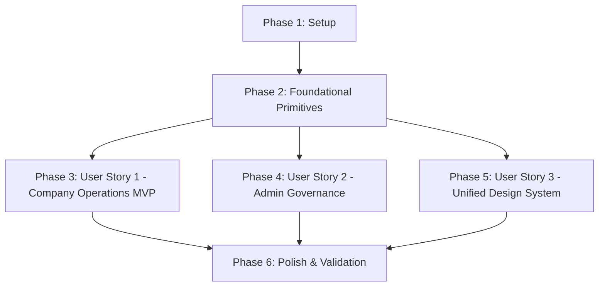

# Tasks: Clean Management UI (Company & Admin Refit)

**Branch**: `001-clean-management-ui` | **Spec**: [spec.md](./spec.md) | **Plan**: [plan.md](./plan.md)  
**Date**: 2026-09-25  

---

## Phase 1: Setup (Shared Infrastructure)

**Purpose**: Establish anti-AI-slop design tokens, color constants, and base styling rules across web and mobile.

- [X] T001 [P] Implement clean management design tokens in `frontend/lib/management-tokens.ts` using definitions from `contracts/ui-design-tokens.json`
- [X] T002 [P] Configure quiet luxury surface colors, subtle borders, and semantic status pill classes in `frontend/tailwind.config.ts`
- [X] T003 [P] Add mobile management color tokens and surface styles in `frontend-expo/constants/theme.ts` matching `contracts/ui-design-tokens.json`

---

## Phase 2: Foundational (Blocking Prerequisites)

**Purpose**: Core UI primitives that MUST be complete before ANY management user story can be refitted.

**⚠️ CRITICAL**: No user story refit work can begin until this foundational phase is complete.

- [X] T004 Implement `StatusPill` component with 5 quiet semantic tiers (`success`, `warning`, `critical`, `info`, `neutral`) in `frontend/components/admin/StatusPill.tsx` per `data-model.md`
- [X] T005 [P] Implement `ManagementDataGrid` component supporting debounced search, fixed headers, sorting, and pagination in `frontend/components/admin/ManagementDataGrid.tsx` per `contracts/datagrid-contract.md`
- [X] T006 [P] Implement `SlideoverDrawer` component with focus trap, backdrop blur, and escape key handling in `frontend/components/admin/SlideoverDrawer.tsx` per `contracts/drawer-contract.md`
- [X] T007 [P] Implement `ConfirmationDialog` component with mandatory reason-code selection for destructive actions in `frontend/components/admin/ConfirmationDialog.tsx`
- [X] T008 [P] Implement mobile high-density `ManagementCard` and `MobileStatusPill` components in `frontend-expo/components/admin/ManagementCard.tsx`

**Checkpoint**: Core foundational components ready — user story implementation can now begin in parallel.

---

## Phase 3: User Story 1 - Streamlined Company Operations Workspace (Priority: P1) 🎯 MVP

**Goal**: Deliver a high-density, distraction-free operations interface for company dispatchers and managers, enabling 3-click job dispatch, staff roster management, and catalog pricing updates without decorative clutter.

**Independent Test**: A company manager can log into `/company/bookings`, view incoming unassigned bookings in a clean tabular view, assign an available technician via an inline drawer or dropdown, and confirm the assignment in under 3 clicks without page reloads.

### Implementation for User Story 1

- [X] T009 [P] [US1] Refit company bookings list with `ManagementDataGrid` in `frontend/app/company/bookings/page.tsx` displaying customer, scheduled time, technician, and status pill
- [X] T010 [P] [US1] Implement `BookingDispatchDrawer` in `frontend/components/company/BookingDispatchDrawer.tsx` allowing one-click staff assignment sorted by availability
- [X] T011 [P] [US1] Refit field staff roster into a high-density table in `frontend/app/company/staff/page.tsx` showing active job counts, current availability, and direct status toggles
- [X] T012 [P] [US1] Refit service catalog into a clean tabular layout with inline price editing and active toggles in `frontend/app/company/services/page.tsx`
- [X] T013 [P] [US1] Refit company overview dashboard in `frontend/app/company/dashboard/page.tsx` replacing decorative cards with actionable operational metric links
- [X] T014 [US1] Refit mobile company booking and dispatch cards in `frontend-expo/app/(company)/(tabs)/today.tsx` to use high-density cards and quiet status badges
- [X] T015 [US1] Refit mobile company staff screen in `frontend-expo/app/(company)/(tabs)/staff.tsx` with unified compact roster cards

**Checkpoint**: Company management workspace is fully functional, free of decorative clutter, and independently testable on both web and mobile.

---

## Phase 4: User Story 2 - High-Efficiency Platform Superadmin Governance (Priority: P2)

**Goal**: Deliver an authoritative, clean governance console for platform superadmins to process company verification queues, inspect submitted credentials in split-views, mediate customer disputes, and audit financial payouts.

**Independent Test**: An administrator can navigate to `/admin/verification`, inspect an unverified provider's business license in `VerificationDrawer`, and issue an approval or reason-coded rejection with zero layout distortion.

### Implementation for User Story 2

- [X] T016 [P] [US2] Refit admin verification queue using `ManagementDataGrid` with status filters in `frontend/app/admin/verification/page.tsx`
- [X] T017 [P] [US2] Implement split-panel `VerificationDrawer` in `frontend/components/admin/VerificationDrawer.tsx` showing document previews alongside approval/rejection forms
- [X] T018 [P] [US2] Refit company directory list and suspend/tier action flows in `frontend/app/admin/companies/page.tsx` with two-step `ConfirmationDialog`
- [X] T019 [P] [US2] Refit company 360° profile view in `frontend/app/admin/companies/[id]/page.tsx` with sticky action header and structured tab panels
- [X] T020 [P] [US2] Refit dispute mediation list and detail views in `frontend/app/admin/disputes/page.tsx` and `frontend/app/admin/disputes/[id]/page.tsx`
- [X] T021 [P] [US2] Refit bank payout authorization ledger into a high-density monospace table in `frontend/app/admin/payouts/page.tsx`
- [X] T022 [US2] Refit mobile admin companies verification screen in `frontend-expo/app/(admin)/(tabs)/companies.tsx` with clean review cards and action sheets
- [X] T023 [US2] Refit mobile admin category creation and management forms in `frontend-expo/app/(admin)/categories/new.tsx`

**Checkpoint**: Superadmin governance workflows are fully operational with quiet luxury styling and reliable audit safeguards.

---

## Phase 5: User Story 3 - Unified Design System & Information Architecture (Priority: P3)

**Goal**: Harmonize visual hierarchy, navigation rhythm, and responsive layouts across all remaining secondary admin and company management sub-pages.

**Independent Test**: Navigating between any admin sub-pages (e.g., from Bookings to Transactions to Compliance) preserves identical header alignments, search bar behaviors, pagination controls, and quiet status badge styling.

### Implementation for User Story 3

- [X] T024 [P] [US3] Refit platform transaction ledger and detail views in `frontend/app/admin/transactions/page.tsx` with monospace amounts and timestamps
- [X] T025 [P] [US3] Refit compliance review list and document inspection drawers in `frontend/app/admin/compliance/page.tsx`
- [X] T026 [P] [US3] Refit user management directory in `frontend/app/admin/users/page.tsx` with role filtering and account moderation triggers
- [X] T027 [P] [US3] Refit service types and category catalog lists in `frontend/app/admin/service-types/page.tsx` and `frontend/app/admin/categories/page.tsx`
- [X] T028 [P] [US3] Standardize breadcrumb navigation and sticky page header rhythm across all admin layouts in `frontend/app/admin/layout.tsx`
- [X] T029 [P] [US3] Standardize breadcrumb navigation and sticky page header rhythm across all company layouts in `frontend/app/company/layout.tsx`
- [X] T030 [US3] Standardize mobile admin layout headers and tab bar styling in `frontend-expo/app/(admin)/_layout.tsx`
- [X] T031 [US3] Standardize mobile company layout headers and tab bar styling in `frontend-expo/app/(company)/_layout.tsx`

**Checkpoint**: All 50+ management routes across web and mobile adhere to a unified, predictable, anti-AI-slop design standard.

---

## Phase 6: Polish & Cross-Cutting Concerns

**Purpose**: Validation, responsive edge-case hardening, accessibility checks, and automated regression testing.

- [X] T032 [P] Implement responsive table collapse logic converting multi-column grids to structured vertical cards on tablet viewports in `frontend/components/admin/ManagementDataGrid.tsx`
- [X] T033 [P] Implement quiet, contextual empty states for all zero-data scenarios across web management views in `frontend/components/admin/EmptyState.tsx`
- [X] T034 Verify WCAG 2.1 AA color contrast across all quiet status badges and text tokens in `frontend/lib/management-tokens.ts`
- [X] T035 Execute full quickstart validation scenarios defined in `specs/001-clean-management-ui/quickstart.md`
- [X] T036 Run automated frontend tests (`npm run test:unit` in `frontend` and `npx tsc --noEmit` in `frontend-expo`)

---

## Dependencies & Execution Order

### Phase Dependencies



- **Phase 1 (Setup)**: Can start immediately. Zero dependencies.
- **Phase 2 (Foundational)**: Depends on Phase 1 tokens. Blocks all user stories.
- **Phase 3 (User Story 1 - MVP)**: Can start as soon as Phase 2 primitives are ready.
- **Phase 4 (User Story 2)**: Can run in parallel with Phase 3 or sequentially after Phase 3.
- **Phase 5 (User Story 3)**: Can run after Phase 2; harmonizes secondary pages across the ecosystem.
- **Phase 6 (Polish)**: Executes after all target user stories are implemented.

---

## Parallel Execution Opportunities

### User Story 1 (Company Operations)
```bash
# Web components can be developed in parallel:
Task: T009 "Refit company bookings list in frontend/app/company/bookings/page.tsx"
Task: T011 "Refit field staff roster in frontend/app/company/staff/page.tsx"
Task: T012 "Refit service catalog in frontend/app/company/services/page.tsx"
```

### User Story 2 (Admin Governance)
```bash
# Admin queues and verification drawers can be developed in parallel:
Task: T016 "Refit admin verification queue in frontend/app/admin/verification/page.tsx"
Task: T018 "Refit company directory list in frontend/app/admin/companies/page.tsx"
Task: T021 "Refit bank payout authorization ledger in frontend/app/admin/payouts/page.tsx"
```

---

## Implementation Strategy

### 1. MVP Delivery (User Story 1 Only)
1. Complete Phase 1 (Tokens & Tailwind styling).
2. Complete Phase 2 (DataGrid, Drawer, StatusPill primitives).
3. Complete Phase 3 (Company operations: Bookings, Staff, Services).
4. **Validate MVP**: Test company dispatching and staff roster workflows using Scenario 2 of `quickstart.md`.

### 2. Incremental Expansion (User Story 2 & 3)
1. Layer on Superadmin governance (Verification queue, Company 360 profiles, Dispute mediation).
2. Refit secondary catalog and financial ledger routes.
3. Apply mobile companion enhancements in `frontend-expo`.
4. Run complete quickstart validation and automated test suites.
