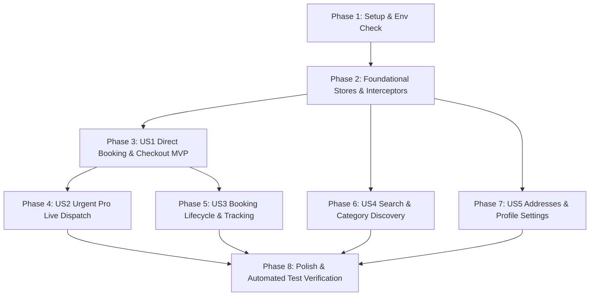

# Tasks: Mobile End-to-End Flow & Real API Cleanup

**Feature**: `006-mobile-flow-cleanup`  
**Input**: [spec.md](./spec.md), [plan.md](./plan.md), [data-model.md](./data-model.md)  
**Status**: Ready for Implementation  

---

## Phase 1: Setup & Environment Verification

**Purpose**: Confirm environment services, database seeds, and API endpoints are reachable.

- [X] T001 Verify NestJS backend API is running on `http://localhost:5000` with 25+ real-image seeded services in PostgreSQL.
- [X] T002 Verify Expo development client in `frontend-expo` is running and configured with `API_URL` pointing to the NestJS backend.

---

## Phase 2: Foundational (Blocking Prerequisites)

**Purpose**: Core client infrastructure required before wiring individual user stories.

- [X] T003 Ensure `frontend-expo/store/authStore.ts` safely handles unauthenticated guest requests without triggering 401 refresh loops or console error storms.
- [X] T004 Ensure `frontend-expo/store/customerHomeStore.ts` handles stale-while-revalidate caching and normalizes backend service image URLs.
- [X] T005 [P] Verify centralized theme tokens in `frontend-expo/constants/theme.ts` provide consistent trade pastel palettes and tactile button scale styles.

---

## Phase 3: User Story 1 - Direct Service Booking & 1-Tap Checkout (Priority: P1) 🎯 MVP

**Goal**: Deliver a Grab/PassApp-style direct booking flow where customers pick a service, see upfront pricing and proximity, and confirm their order in $\le 4$ taps.

**Independent Test**: Navigate from Home $\rightarrow$ tap service card $\rightarrow$ view details $\rightarrow$ tap "Book Pro Now" $\rightarrow$ confirm in Checkout $\rightarrow$ verify `POST /api/bookings` succeeds and redirects to active booking.

- [X] T006 [US1] Remove legacy company storefront redirects on `frontend-expo/app/(customer)/(tabs)/home.tsx`; wire service cards directly to service detail and booking sheets.
- [X] T007 [US1] Audit `frontend-expo/app/(customer)/service/[id].tsx` to render real backend imagery, duration, checklist, and upfront pricing with a prominent "Book Pro Now" button.
- [X] T008 [US1] Update `frontend-expo/app/(customer)/checkout.tsx` to bind customer GPS coordinates (`customLat`, `customLng`) and formatted street address instead of hardcoded city names.
- [X] T009 [US1] Wire Cash on Completion (`cash`) alongside Bakong KHQR (`khqr`) in `frontend-expo/app/(customer)/checkout.tsx` with double-tap submission guards and loading spinners.
- [X] T010 [US1] Implement inline guest authentication bottom sheet in `frontend-expo/app/(customer)/checkout.tsx` to allow instant OTP/password login without navigating away or losing draft selections.

---

## Phase 4: User Story 2 - Instant "Urgent Pro" Live Dispatch Flow (Priority: P1)

**Goal**: Enable 1-tap emergency dispatch on live map with auto-match to the nearest verified technician.

**Independent Test**: Tap "Urgent Pro" on Home $\rightarrow$ confirm pin on `map-view.tsx` $\rightarrow$ tap "Dispatch Pro" $\rightarrow$ verify instant request creation and live technician radar.

- [X] T011 [US2] Wire "Urgent Pro" button on `frontend-expo/app/(customer)/(tabs)/home.tsx` to open `map-view.tsx?mode=instant` with customer GPS coordinates.
- [X] T012 [US2] Connect `frontend-expo/app/(customer)/map-view.tsx` to `POST /api/instant-requests` for immediate emergency request generation.
- [X] T013 [US2] Implement single nearest pro auto-assignment and live ETA route polyline tracking in `frontend-expo/app/(customer)/map-view.tsx`.

---

## Phase 5: User Story 3 - Active Booking Tracking & Lifecycle Management (Priority: P2)

**Goal**: Provide live status tracking, direct contact with assigned technicians, cancellation, and review submission.

**Independent Test**: Open an active booking $\rightarrow$ verify timeline status $\rightarrow$ test "Call Staff" and "Chat with Staff" $\rightarrow$ test cancellation and review submission.

- [X] T014 [US3] Ensure the Active Booking pulse card on `home.tsx` automatically binds to the user's latest active booking and links directly to `booking/[id].tsx`.
- [X] T015 [US3] Verify `frontend-expo/app/(customer)/booking/[id].tsx` wires functional native phone dialing (`tel:...`) and in-app chat navigation (`messages.tsx`).
- [X] T016 [US3] Connect "Cancel Booking" action to `POST /api/bookings/:id/cancel` with confirmation modal and status update in `booking/[id].tsx` and `booking/cancel.tsx`.
- [X] T017 [US3] Connect "Leave Review" submission in `booking/[id].tsx` to `POST /api/reviews` with 1–5 star ratings and comment payload.

---

## Phase 6: User Story 4 - Discovery, Search & Category Catalog (Priority: P2)

**Goal**: Fast, intuitive discovery via pastel trade category plates and debounced keyword search.

**Independent Test**: Tap category plates $\rightarrow$ verify filtered trade results $\rightarrow$ type search query $\rightarrow$ verify debounced backend results.

- [X] T018 [US4] Connect category plates on `home.tsx` to `frontend-expo/app/(customer)/category/[id].tsx` with matching trade pastel themes and real seeded services.
- [X] T019 [US4] Audit `frontend-expo/app/(customer)/(tabs)/explore.tsx` to verify debounced search queries against `GET /api/services` and instant chip filtering.

---

## Phase 7: User Story 5 - Account, Saved Addresses & Profile Settings (Priority: P3)

**Goal**: Retain customer preferences, manage delivery addresses, and ensure clean sign-out.

**Independent Test**: Navigate to Profile $\rightarrow$ create saved address $\rightarrow$ verify it appears in Checkout $\rightarrow$ test sign out.

- [X] T020 [US5] Wire Saved Addresses in `frontend-expo/app/(customer)/address/index.tsx` and `checkout.tsx` to `GET /api/users/addresses` and `POST /api/users/addresses`.
- [X] T021 [US5] Verify notification bell on `home.tsx` links to `frontend-expo/app/(customer)/notifications.tsx` with read/unread statuses.
- [X] T022 [US5] Verify Sign Out on `frontend-expo/app/(customer)/(tabs)/profile.tsx` clears `authToken` from SecureStore and resets customer state cleanly to guest.

---

## Phase 8: Polish, Cross-Cutting & Verification

**Purpose**: System-wide regression checks, type safety, and test suites.

- [X] T023 Run TypeScript compiler verification (`npx tsc --noEmit`) in `frontend-expo` and resolve all diagnostic errors.
- [X] T024 Run Jest test suite (`npm test`) in `frontend-expo` ensuring 100% passing tests.
- [X] T025 Execute end-to-end verification checklist per `specs/006-mobile-flow-cleanup/quickstart.md`.

---

## Dependencies & Execution Order

---

## Implementation Strategy

### MVP First (Phases 1, 2, and 3)
1. Complete Foundational interceptor and store validation.
2. Implement Direct Booking and Checkout (US1).
3. Validate an end-to-end booking from Home to Confirmation.

### Incremental Feature Expansion
4. Add Urgent Pro instant map dispatch (US2).
5. Add Booking Lifecycle management, calling, and reviews (US3).
6. Polish Search, Categories, and Saved Addresses (US4, US5).
7. Validate 100% TypeScript compliance and Jest test suites.
