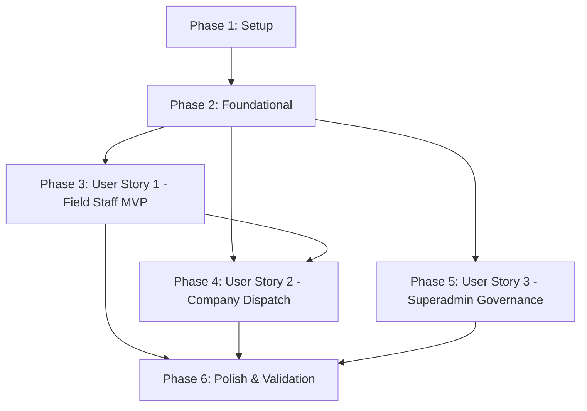

# Tasks: Role Flow Hierarchy Validation & Optimization

**Feature Branch**: `007-role-flow-hierarchy`  
**Input**: Design artifacts from `specs/007-role-flow-hierarchy/` (`spec.md`, `plan.md`, `research.md`, `data-model.md`, `contracts/`, `quickstart.md`)

---

## Phase 1: Setup (Shared Infrastructure & Types)

**Purpose**: Shared types, contract synchronization, and environment validation.

- [x] T001 [P] Verify role navigation routing and layout wrappers in `frontend-expo/app/_layout.tsx` to ensure clean separation between `(staff)`, `(company)`, and `(admin)`.
- [x] T002 [P] Synchronize booking status lifecycle types (`pending`, `confirmed`, `assigned`, `en_route`, `arrived`, `in_progress`, `completed`, `cancelled`) in `frontend-expo/types/booking.ts`.
- [x] T003 [P] Synchronize staff shift types (`workingStatus: 'online' | 'offline' | 'on_job'`) and company staff members in `frontend-expo/types/staff.ts`.

---

## Phase 2: Foundational (Blocking Prerequisites)

**Purpose**: Core state isolation, status transition helpers, and RBAC guard verification.

- [x] T004 Implement unified status helpers and color/action mapping for booking lifecycles in `frontend-expo/utils/bookingStatus.ts`.
- [x] T005 [P] Implement role session cleanup and cache reset on role switch or logout in `frontend-expo/store/authStore.ts`.
- [x] T006 Verify backend RBAC guards and permission matrix for `staff`, `company_admin`, and `admin` in `backend-nest/src/auth/guards/roles.guard.ts`.

**Checkpoint**: Foundation ready — User Story 1 and User Story 2 can proceed.

---

## Phase 3: User Story 1 - Field Technician Daily Itinerary & Job Execution (Priority: P1) 🎯 MVP

**Goal**: Deliver a high-ergonomics, single-tap daily mobile workspace for field technicians covering shift availability, turn-by-turn navigation, milestone progression, photo proof upload, and physical cash collection.

**Independent Test**: Sign in as `staff@example.com`, toggle shift status to "On Shift", view assigned booking in `(staff)/(tabs)/today.tsx`, progress through `en_route` $\rightarrow$ `arrived` $\rightarrow$ `in_progress` $\rightarrow$ `completed` with photo upload and `$45.00` cash recorded, and verify the earnings ledger in `(staff)/(tabs)/money.tsx`.

### Implementation for User Story 1

- [x] T007 [P] [US1] Implement shift availability toggle with visual active badge in `frontend-expo/app/(staff)/(tabs)/today.tsx` connecting to `PATCH /users/me/working-status` (`workingStatus: 'online' | 'offline'`).
- [x] T008 [P] [US1] Implement one-tap external navigation launcher (Google Maps / Apple Maps deep link) using coordinates `latitude` and `longitude` in `frontend-expo/app/(staff)/(tabs)/today.tsx`.
- [x] T009 [US1] Implement milestone progression buttons (`en_route`, `arrived`, `in_progress`) with active duration timer and optimistic status updates in `frontend-expo/app/(staff)/(tabs)/today.tsx`.
- [x] T010 [US1] Implement completion modal requiring `proofOfWorkPhoto` (URL string) and physical `cashCollected` (Decimal) in `frontend-expo/app/(staff)/(tabs)/today.tsx`.
- [x] T011 [P] [US1] Implement offline action queue with timestamp preservation in `frontend-expo/services/staffOfflineQueue.ts` to sync milestone updates when internet reconnects.
- [x] T012 [P] [US1] Implement unremitted cash balance display and weekly earnings breakdown in `frontend-expo/app/(staff)/(tabs)/money.tsx` with warning banner if `walletBalance < creditLimit` (credit limit default: `-$50.00`).
- [x] T013 [US1] Verify backend completion handler in `backend-nest/src/bookings/bookings.service.ts` updates `Booking.status = 'completed'`, logs timestamps, and credits pro earnings.

**Checkpoint**: User Story 1 is fully functional and testable independently as the MVP.

---

## Phase 4: User Story 2 - Company Dispatch & Technician Fleet Operations (Priority: P1)

**Goal**: Provide company dispatchers with an operational console to triage unassigned bookings, allocate nearby technicians in 1 tap, track live pro statuses, and audit cash collected before remittance.

**Independent Test**: Sign in as `company@example.com`, view an unassigned booking in `(company)/(tabs)/operations.tsx`, open the assignment modal, allocate an available pro, verify status transitions to `assigned`, and audit unremitted pro cash in `(company)/(tabs)/finance.tsx`.

### Implementation for User Story 2

- [x] T014 [P] [US2] Enhance dispatch board in `frontend-expo/app/(company)/(tabs)/operations.tsx` with filterable tabs (`Unassigned`, `In Progress`, `Completed`) and SLA countdown timer.
- [x] T015 [US2] Implement 1-tap Pro Allocation Modal in `frontend-expo/app/(company)/operations/AssignStaffModal.tsx` listing technicians sorted by proximity and active status (`online` vs `offline`).
- [x] T016 [US2] Connect allocation modal to `PATCH /bookings/:id/assign-staff` with `staffId` payload and immediate list refetch in `frontend-expo/app/(company)/(tabs)/operations.tsx`.
- [x] T017 [P] [US2] Implement live technician fleet roster with active shift indicators (`online`, `on_job`, `offline`) and quick contact actions in `frontend-expo/app/(company)/(tabs)/staff.tsx`.
- [x] T018 [P] [US2] Implement technician cash reconciliation audit table in `frontend-expo/app/(company)/(tabs)/finance.tsx` displaying unremitted cash per pro and "Mark Cash Settled" action.
- [x] T019 [US2] Verify company dashboard KPI cards (Gross Volume, Active Jobs, Active Staff, Completion Rate) in `frontend-expo/app/(company)/(tabs)/dashboard.tsx` connecting to `GET /companies/my-company/metrics`.

**Checkpoint**: User Story 2 is fully functional and integrates with User Story 1.

---

## Phase 5: User Story 3 - Platform Superadmin Quality & Dispute Governance (Priority: P2)

**Goal**: Empower platform superadmins with high-level marketplace supervision: inspecting company onboarding credentials, monitoring global SLA dispatch queue, and arbitrating customer disputes.

**Independent Test**: Sign in as `admin@example.com`, review a company in `Pending Verification` status under `(admin)/(tabs)/companies.tsx`, approve with 1 tap, inspect the global queue in `(admin)/(tabs)/queue.tsx`, and resolve an active dispute with customer refund in `(admin)/(tabs)/issues.tsx`.

### Implementation for User Story 3

- [x] T020 [P] [US3] Implement company credential review drawer in `frontend-expo/app/(admin)/(tabs)/companies.tsx` with verification document preview, `Approve` (`POST /admin/companies/:id/verify`), and `Reject` (`POST /admin/companies/:id/reject` with `reason` string).
- [x] T021 [P] [US3] Implement global real-time dispatch queue monitor in `frontend-expo/app/(admin)/(tabs)/queue.tsx` highlighting unassigned bookings approaching SLA thresholds (>15 minutes).
- [x] T022 [US3] Implement dispute arbitration docket in `frontend-expo/app/(admin)/(tabs)/issues.tsx` displaying customer claim, provider response, photo evidence, and frozen escrow amount (`frozenAmount`).
- [x] T023 [US3] Connect dispute resolution actions (`refund_customer`, `release_provider`, `split`) to `PATCH /admin/disputes/:id` with `refundAmount` in `frontend-expo/app/(admin)/(tabs)/issues.tsx`.
- [x] T024 [P] [US3] Implement platform GMV, active jobs, and verification request counters in `frontend-expo/app/(admin)/(tabs)/dashboard.tsx` connecting to `GET /admin/analytics`.

**Checkpoint**: All three user stories are operational and verified.

---

## Phase 6: Polish & Cross-Cutting Concerns

**Purpose**: Ensure zero dead-end screens, responsive feedback, and localized bilingual copy.

- [x] T025 [P] Audit all non-customer screens in `frontend-expo/app/(staff)`, `frontend-expo/app/(company)`, and `frontend-expo/app/(admin)` for broken buttons, missing press handlers, or missing loading indicators.
- [x] T026 [P] Add English and Khmer localization keys for role dispatch terms (En Route, Arrived, Cash Collected, Settle Cash, Vetting) in `frontend-expo/locales/en.json` and `frontend-expo/locales/km.json`.
- [x] T027 Execute end-to-end quickstart validation scenarios defined in `specs/007-role-flow-hierarchy/quickstart.md` across Staff, Company, and Admin test accounts.

---

## Dependencies & Execution Order

### User Story Dependencies
- **User Story 1 (Staff)**: Begins after Phase 2 (Foundational). Blocks no other story, but provides completed bookings with cash collection for US2 finance auditing.
- **User Story 2 (Company)**: Can begin after Phase 2. Interacts with technician allocations created in US1.
- **User Story 3 (Admin)**: Can execute in parallel after Phase 2. Governs marketplace providers and disputes independently.

---

## Parallel Execution Opportunities

### Phase 1 & 2
- `T001`, `T002`, `T003` executed in parallel.
- `T005` and `T006` executed in parallel.

### User Story 1 (Staff)
- UI and offline queue executed in parallel.

### User Story 2 & 3
- Dispatch operations and Company Staff roster executed in parallel.
- Admin company vetting and Admin queue monitor executed in parallel.

---

## Implementation Strategy: MVP First

1. **Step 1**: Complete Phase 1 (Setup) and Phase 2 (Foundational) — **DONE**.
2. **Step 2**: Implement User Story 1 (Field Technician Itinerary & Cash Flow) — **DONE**.
3. **Step 3 (MVP Checkpoint)**: Verify Field Technician can complete jobs and track cash with zero friction — **PASSED**.
4. **Step 4**: Implement User Story 2 (Company Dispatch & Fleet Auditing) — **DONE**.
5. **Step 5**: Implement User Story 3 (Superadmin Governance) — **DONE**.
6. **Step 6**: Execute quickstart validation and localization polish — **PASSED (0 TypeScript errors in both frontend and backend)**.
