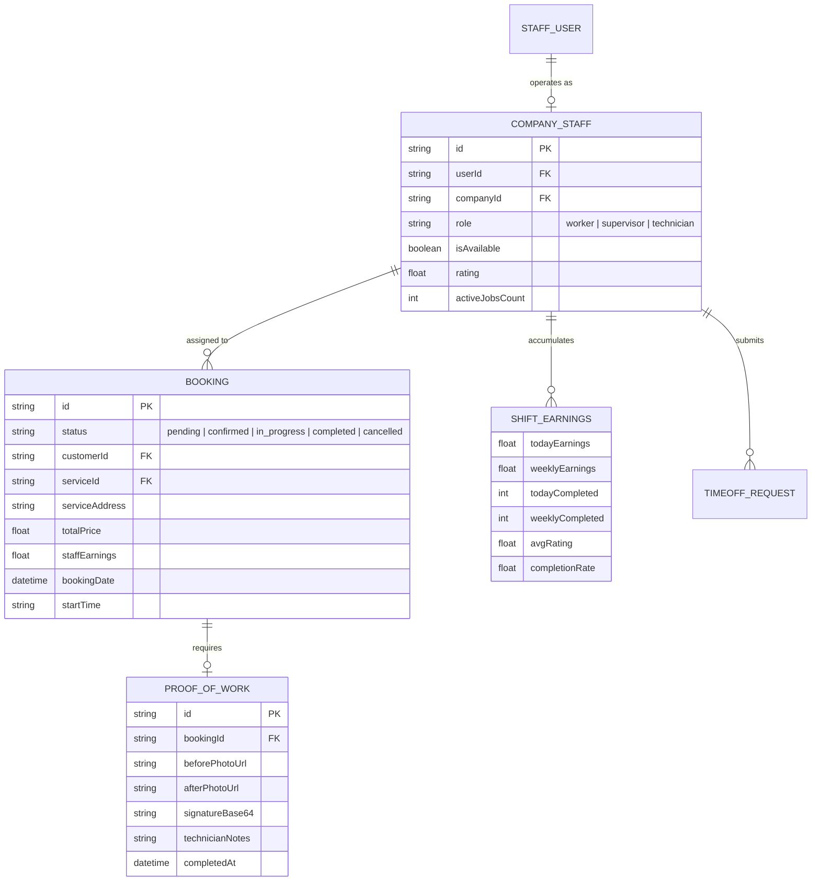
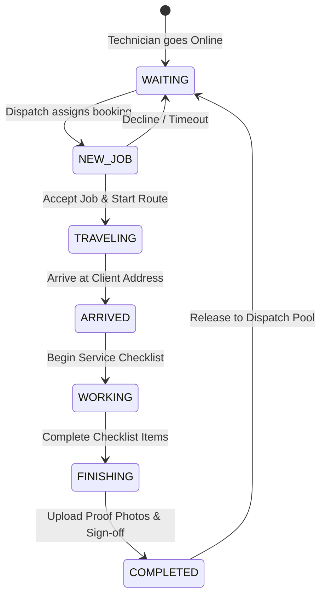

# Phase 1 Data Model: Staff Experience & Field Operations

**Feature**: `012-staff-experience-alignment`
**Date**: 2026-10-06
**Status**: Completed

---

## Entity Models & Relationships



---

## State Transition Model: Field Service State Machine



---

## Key Data Contracts

### 1. Shift Performance Endpoint: `GET /api/staff/performance`
```typescript
interface StaffPerformanceResponse {
  todayEarnings: number;
  weeklyEarnings: number;
  todayCompleted: number;
  weeklyCompleted: number;
  avgRating: number;
  completionRate: number;
  responseRate: number;
  weeklyChart: Array<{
    day: string; // 'Mon', 'Tue', ...
    amount: number;
    isToday: boolean;
  }>;
}
```

### 2. Dispatched Assignments Endpoint: `GET /api/bookings/my-assignments`
```typescript
interface StaffAssignmentResponse {
  bookings: Array<{
    id: string | number;
    bookingDate: string;
    startTime: string;
    endTime?: string;
    serviceAddress: string;
    totalPrice: number;
    staffEarnings?: number;
    status: 'pending' | 'confirmed' | 'in_progress' | 'completed' | 'cancelled';
    service?: { name: string };
    customer?: { fullName: string; phone?: string };
    checklist?: any[];
  }>;
}
```
