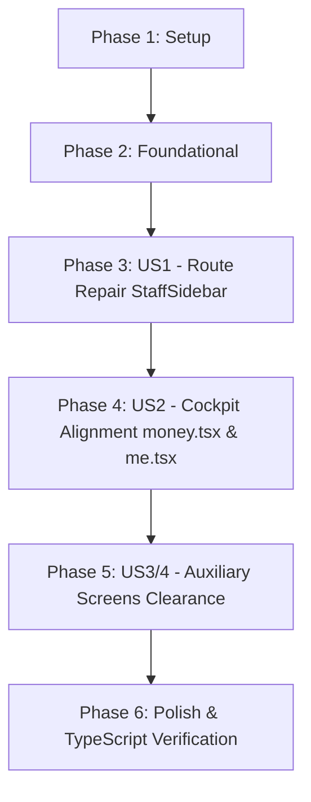

# Tasks: Staff Experience Alignment & Navigation Audit

**Feature**: `012-staff-experience-alignment`  
**Input**: Feature specification from `specs/012-staff-experience-alignment/spec.md`  
**Status**: Ready for implementation

---

## Phase 1: Setup & Codebase Baseline

**Purpose**: Baseline verification and scope isolation

- [X] T001 Verify active git status and branch `012-staff-experience-alignment`
- [X] T002 Run baseline TypeScript validation with `npx tsc --noEmit` in `frontend-expo`

---

## Phase 2: Foundational Prerequisites

**Purpose**: Route mapping and design token alignment

- [X] T003 Audit route contracts against physical screens in `frontend-expo/app/(staff)/**`
- [X] T004 Confirm design tokens in `frontend-expo/constants/theme.ts` for cockpit styling

---

## Phase 3: User Story 1 - Flawless Field Navigation & Sidebar Routing (Priority: P1) 🎯 MVP

**Goal**: Repair all broken navigation routes in `StaffSidebar.tsx` to eliminate router warnings and dead ends.

**Independent Test**:
- Open the drawer sidebar in the Staff app.
- Tap every item (`Live Dispatch`, `My Availability`, `Shift Earnings`, `Staff Profile`, `Job History`, `Performance Score`, `Request Leave`, `AI Job Diagnostics`, `Contact Dispatch`).
- Verify each item navigates cleanly to the intended operational screen.

### Implementation Tasks for User Story 1

- [X] T005 [US1] Re-map `NAV_GROUPS` in `frontend-expo/components/StaffSidebar.tsx` to valid target routes (`/(staff)/(tabs)/today`, `/(staff)/availability`, `/(staff)/(tabs)/money`, `/(staff)/(tabs)/me`, `/(staff)/history`, `/(staff)/performance`, `/(staff)/timeoff`, `/(staff)/ai/ai`, `/(staff)/messages/new`)
- [X] T006 [US1] Update `isActive` route normalization in `frontend-expo/components/StaffSidebar.tsx` to correctly handle both tab and non-tab routes

**Checkpoint**: At this point, User Story 1 is fully functional and testable independently.

---

## Phase 4: User Story 2 - Corporate Cockpit Design System Alignment (Priority: P1)

**Goal**: Standardize visual design and tokens on primary staff tabs (`money.tsx` and `me.tsx`) with pure white cards (`#FFFFFF`), hairline borders (`#E2E8F0`), deep charcoal typography (`#0F172A`), and safe bottom clearance (`paddingBottom: 120`).

**Independent Test**:
- Open the `Money` and `Profile` tabs.
- Verify high-contrast white cards, hairline borders, legible charcoal typography, and zero occlusion by the floating bottom tab bar.

### Implementation Tasks for User Story 2

- [X] T007 [US2] Refactor `frontend-expo/app/(staff)/(tabs)/money.tsx` to replace hardcoded legacy token maps (`#0A192F`, `#F7F8FC`) with pure white cards `#FFFFFF`, hairline borders `#E2E8F0`, deep charcoal `#0F172A` headers, discrete status dots, and `contentContainerStyle={{ paddingBottom: 120 }}`
- [X] T008 [US2] Refactor `frontend-expo/app/(staff)/(tabs)/me.tsx` to replace legacy color tokens with pure white cards `#FFFFFF`, hairline borders `#E2E8F0`, deep charcoal `#0F172A` profile headers, and `contentContainerStyle={{ paddingBottom: 120 }}`

**Checkpoint**: User Stories 1 and 2 are fully integrated and visually unified.

---

## Phase 5: User Story 3 & 4 - Auxiliary Screens Clearance & Consistency (Priority: P2)

**Goal**: Ensure supporting staff screens (`availability`, `timeoff`, `history`, `performance`) have consistent 120px safe area clearance and cockpit card styling.

**Independent Test**:
- Navigate to each auxiliary screen and scroll to the bottom. Verify no interactive elements or CTA buttons are clipped.

### Implementation Tasks for User Stories 3 & 4

- [X] T009 [P] [US3] Verify and ensure 120px bottom clearance in `frontend-expo/app/(staff)/availability/index.tsx`
- [X] T010 [P] [US3] Verify and ensure 120px bottom clearance in `frontend-expo/app/(staff)/timeoff/index.tsx`
- [X] T011 [P] [US4] Verify and ensure 120px bottom clearance in `frontend-expo/app/(staff)/history.tsx`
- [X] T012 [P] [US4] Verify and ensure 120px bottom clearance in `frontend-expo/app/(staff)/performance/index.tsx`

**Checkpoint**: All staff screens adhere to the safe clearance specification.

---

## Phase 6: Polish & Verification

**Purpose**: Cross-cutting verification and code quality validation

- [X] T013 Run full TypeScript validation (`npx tsc --noEmit`) in `frontend-expo` and verify 0 errors
- [X] T014 Verify `git status` confirms zero modifications under `frontend-expo/app/(customer)/**`
- [X] T015 Verify quickstart validation steps from `specs/012-staff-experience-alignment/quickstart.md`

---

## Dependencies & Execution Order

---

## Implementation Strategy

### MVP First (User Story 1 Only)
1. Complete Phase 1 & Phase 2.
2. Complete User Story 1 (Repair routes in `StaffSidebar.tsx`).
3. Validate sidebar drawer navigation independently.

### Incremental Delivery
1. Deliver US1: Zero dead navigation links.
2. Deliver US2: Modernized `Money` and `Profile` screens with corporate cockpit styling and `paddingBottom: 120`.
3. Deliver US3/4: Safe clearance across all auxiliary screens.
4. Run `npx tsc --noEmit` to confirm 0 compilation errors.
